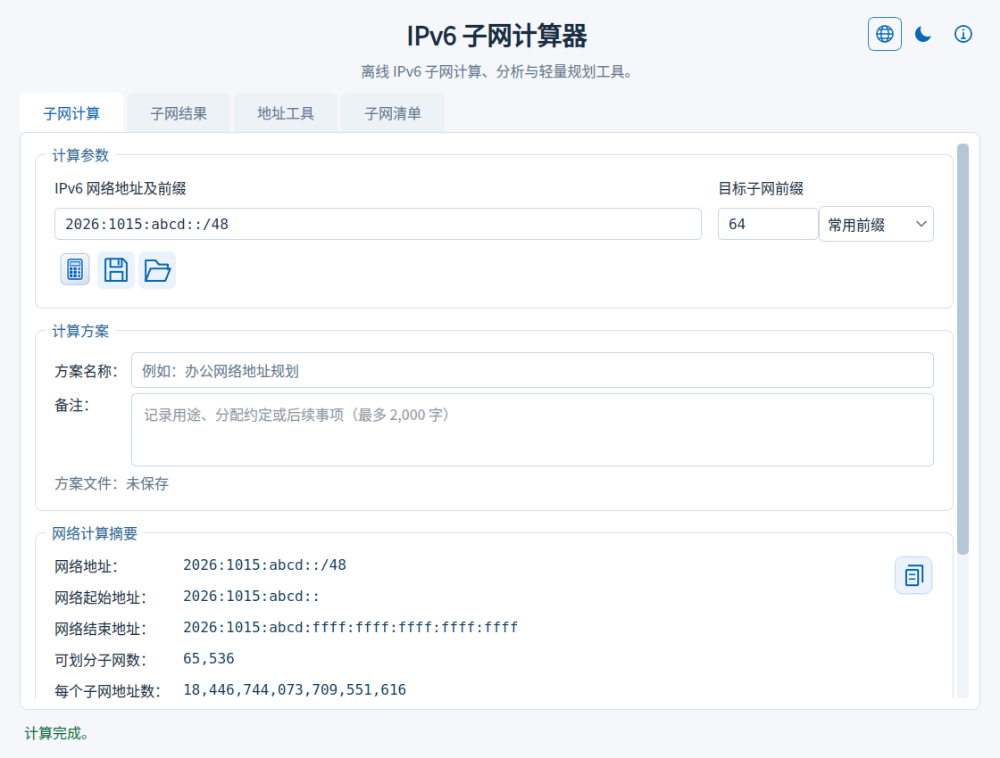
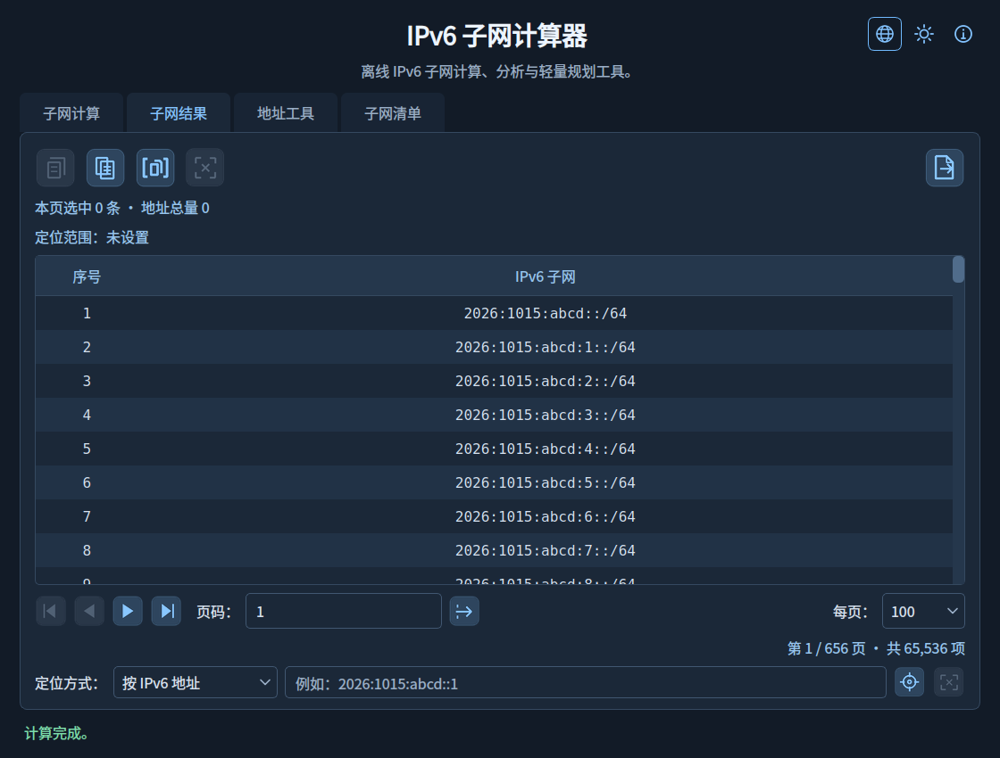
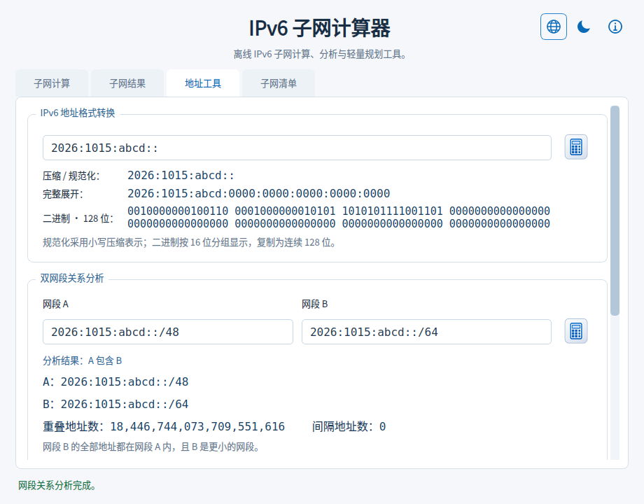
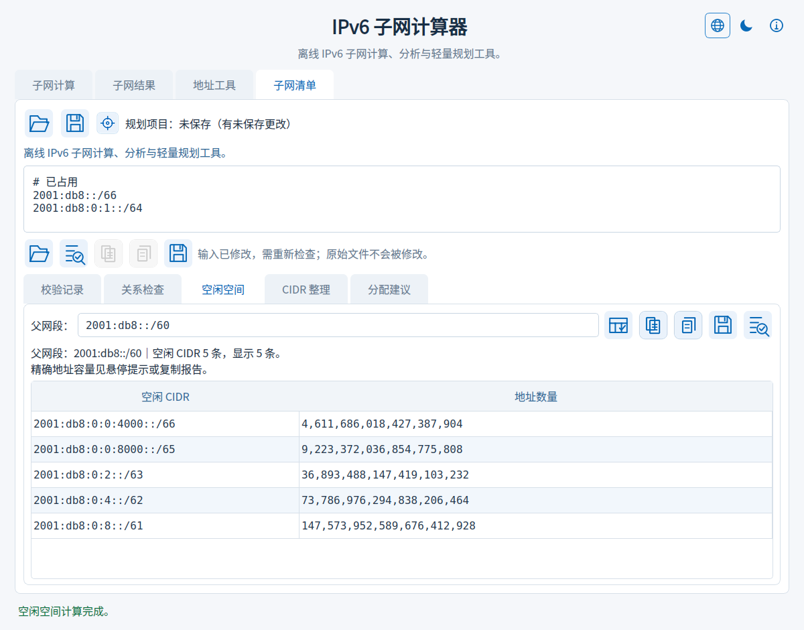
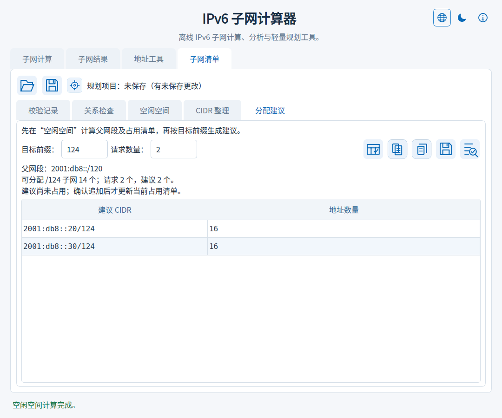
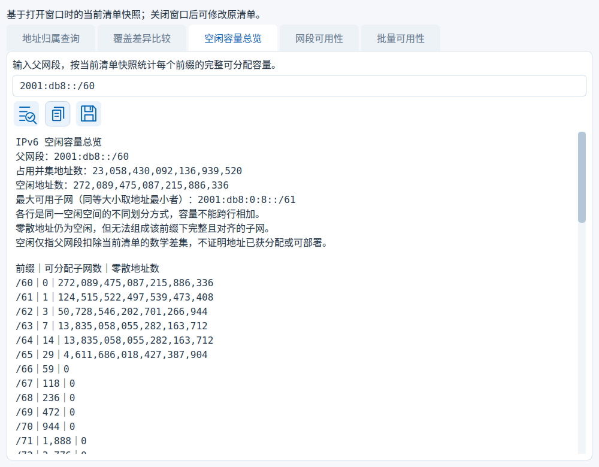

**简体中文** | [English](README_EN.md)

# 🌐 IPv6 子网计算器 V1.15

### V1.15 检查规则补充

新增独立 i18n 门禁、源文规则及结构化翻译检查；新增 Python／Actions CodeQL、PR 依赖审查和本地 Bandit 安全扫描。构建与验证先执行国际化和安全预检。功能、版本和中英文截图保持不变。见 [国际化检查](docs/INTERNATIONALIZATION_CI.md) 和 [安全代码检测](docs/SECURITY_CHECKS.md)。GitHub 扫描及仓库保护需要上传后运行和配置。

## ✨ V1.15 候选网段可用性检查

- 在“子网清单”最上方第三个圆形靶心按钮打开的查询窗口中，新增“网段可用性”页签。输入准备分配的 IPv6 CIDR，判断相对于当前占用清单是否全部空闲、部分占用或全部占用。
- 报告列出所有冲突原始行号，保留重复和包含记录；占用容量按并集计数，只统计候选内覆盖，不相交记录不影响结果。主机位自动规范化。
- 可分别复制／保存候选内空闲与占用的最简 CIDR。结果为空或超过 5,000 条时禁止输出空清单或部分清单，完整范围报告仍可保存。此操作不自动追加或更改原清单。
- 修改候选立即清除旧结果；沿用覆盖确认和保存冲突保护。窗口使用打开时的清单快照，需更新基准时关闭重开；查询参数和结果不写入规划项目 JSON。
- 补全查询入口悬停说明。中文文档仅引用中文截图，英文文档仅引用英文截图；新增检查接入本地构建和 GitHub 质量检查。
- Qt 运行库仍为 6.11.2，本次不包含 Qt 安全升级。上游进度见 [依赖状态](docs/DEPENDENCY_STATUS.md)。

## ✨ V1.14 空闲容量总览

- 在“子网清单”顶部查询窗口新增“空闲容量总览”页：输入父网段，一次统计父前缀至 /128 各级可分配的完整、对齐子网数量。
- 显示空闲地址数、占用并集容量、最大可用子网，以及各前缀下无法组成完整子网的零散地址数；同等大小的最大子网取地址最小者。
- 使用全部空闲范围计算，不受 5,000 条 CIDR 预览截断影响；容量使用精确整数，不枚举 IPv6 地址。每一行都是同一空闲空间的不同划分，不能跨行相加。
- 支持双语报告复制及 TXT 保存，沿用覆盖确认和文件冲突保护；修改父网段立即清除结果。基于打开窗口时的清单快照，不修改原项目，关闭后重开可使用最新清单。
- 占用清单必须全部有效且位于父网段内；空清单表示父网段全空闲。总览输入及结果不保存到规划项目 JSON，需要留存时保存报告。
- 保留 V1.13 CIDR 输出、翻译审计和跨平台换行修复。Qt 运行库保持现有版本，本次不包含 Qt 安全升级。

入口：切换到 **子网清单**，点击最上方文件夹、保存按钮右侧的 **圆形靶心查询图标（第三个按钮）**，在弹窗中选择 **空闲容量总览**。此功能从 V1.14 开始提供。

## ✨ V1.13 查询与比较结果 CIDR 输出

- 地址归属查询支持复制及保存匹配网段 CIDR：规范化、去重，按最长前缀优先排列，保留包含项；原报告仍保留原始行号及重复记录。
- 覆盖比较可分别选择新增、移除、共同覆盖，生成精确覆盖结果的最简 CIDR 清单，支持复制及 TXT 保存后重新导入。
- 显示所选类别的 CIDR 条数。空结果不生成空清单；超过 5,000 条时禁用纯 CIDR 输出，完整地址范围报告仍可保存。
- 修改输入立即清除结果；保存期间切换类别或重新计算会中止旧结果保存。沿用现有覆盖确认及保存冲突保护。
- 同步中英文界面及离线说明，保留已合并的 GitHub Actions 质量检查。Qt 安全升级仍待兼容运行库发布，本版不包含 Qt 漏洞修复。

### 🌐 翻译维护与异常显示

- 新增 TS/QM 一致性检查：核对翻译条目、上下文、完成状态、重复项及格式占位符；配套生成记录可发现翻译修改后漏编译或资源不匹配。
- 新增源码翻译遗漏扫描，检查 `text()` 及其导入别名、显式翻译调用和常用界面文本入口；检查接入构建前流程，回归测试及程序自检继续验证翻译资源。
- 新增翻译编译维护脚本，先在临时目录编译并检查，再更新 QM 及生成记录；编译或检查失败时保留原 QM。
- 翻译格式错误时回退原始消息，避免因占位符错误或译文行数变化引起显示异常；嵌套错误及后台清单错误保留翻译结构，文件路径及用户输入保留原文。
- 将范围分隔符正则移出翻译目录，输入语法不参与翻译。新增维护说明及针对资源损坏、漏翻译、异常显示的回归检查。

## ✨ V1.12 清单查询、覆盖比较与草稿保护

- 新增地址归属查询：输入 IPv6 地址，按最长前缀优先列出清单中所有匹配网段及原始行号，保留重复及包含项。
- 新增覆盖差异比较：当前清单作为基准，与粘贴或导入的 TXT／规划项目清单比较，精确统计新增、移除和共同覆盖的地址数与全部范围；等价 CIDR 拆分不产生虚假变化。
- 两项功能位于“子网清单”顶部查询图标，使用打开窗口时的清单快照；支持复制及 TXT 报告保存，沿用保存冲突保护。输入变化后清除旧结果。
- 单份清单继续限制为 5,000 条、1 MiB、20,000 行；空清单可用于比较全部新增或移除。错误行需修正后再查询或比较。

- 关闭程序或打开其他规划项目时，如有未保存内容，可选择保存、放弃或取消。
- 新草稿与已保存项目均显示未保存更改；只切换结果页签不触发提醒。
- 保存取消、冲突或失败时保留当前工作；提示期间内容变化会中止操作。

## ✨ V1.11 规划项目保存与恢复

- “子网清单”顶部新增打开／另存规划项目图标，分配建议页也可使用。
- 独立 JSON 保存清单原文（含注释和空行）、父网段、分配目标前缀、请求数量和结果页签；支持保存未完成的草稿。
- 恢复前验证文件并确认替换，恢复后清除派生结果，请重新检查或规划。此文件与原有“计算方案”格式分开；Ctrl+S／Ctrl+O 仍操作计算方案。
- 沿用保存冲突保护；对话框期间输入或任务变化时拒绝过期操作。已有项目修改后显示未保存状态。
- 规划项目需手动保存；退出或替换项目时提供未保存确认。
- Qt 依赖维持经验证基线，安全升级仍待处理；本版功能更新不代表漏洞已修复。

离线 IPv6 子网计算、分析与轻量规划工具。

## 📖 项目简介

IPv6SubnetCalculator 是一款适用于 Windows 的离线 IPv6 子网计算工具，可分析网络范围、划分子网、识别地址用途，提供子网计算、子网结果、地址工具及子网清单四个页面，用于浏览、定位、保存子网及分析地址与网段关系。

## ✨ 主要功能

- **网络计算**：支持 `/0`～`/128` 的 IPv6 CIDR，计算网络范围、子网数量、每个子网的地址容量及新增子网位数。提供常用前缀选择、地址规范化和具体输入错误说明。
- **计算摘要复制**：点击“网络计算摘要”右上角复制图标，复制网络范围、源／目标前缀、精确容量和地址用途提示，可直接粘贴到规划文档。
- **地址用途提示**：识别 ULA、6to4、组播、链路本地等地址类型，展示用途、部署限制与规范参考；保留特殊地址的数学划分能力。
- **清晰阅读**：统一加大界面、输入框、结果表格、详情及悬停提示字体，配套调整表格行高和弹窗空间。
- **外观主题**：提供浅色和深色主题，点击右上角月亮／太阳图标切换，或按 Ctrl+Shift+T；自动记住选择。
- **四个功能页**：“子网计算”展示参数、摘要和地址用途；“子网结果”展示表格和操作工具；“地址工具”提供格式转换及双网段分析；“子网清单”检查已有 CIDR 的格式与批量关系。切换标签保留各页状态。
- **地址格式转换**：输出压缩／小写规范化、8 组完整展开和 128 位二进制，支持逐项或全部复制；接受 IPv4 映射的 IPv6 写法。
- **地址范围转 CIDR**：输入包含首末地址的 IPv6 范围，生成精确覆盖该范围的最简 CIDR 清单，显示精确地址总数；可复制清单或报告，并转入“子网清单”继续检查，替换已有内容前确认。
- **双网段关系分析**：输入两个 IPv6 CIDR，判断相同、A 包含 B、B 包含 A、相邻或完全独立，显示精确重叠／间隔地址数，支持复制完整报告。
- **分页与定位**：每页 25、50、100、200 条，支持页码跳转，以及按 IPv6 地址、子网序号或对应范围定位。巨大结果集仅加载当前页，范围高亮跨页保留。
- **选择统计与复制**：显示本页选中数量、首末序号、连续性和地址总量；可复制所选记录、当前页、指定序号范围及完整精确统计。支持 Ctrl/Shift 多选、Ctrl+A、Ctrl+C 和 Esc。
- **子网详情**：双击或按 Enter 查看完整地址范围、地址容量，浏览上一条、下一条并复制详情。
- **文件导出**：全部或指定范围导出为 TXT／Excel（XLSX），提供容量估算、进度与取消操作；临时文件写入完成后才替换目标文件。Excel 表头与工作表名使用开始导出时的界面语言，TXT 每行保留一个 CIDR。

## 💾 计算方案

- **保存与恢复**：将最后一次成功计算保存为本地 JSON，重新打开后自动计算并恢复每页条数、页码、定位范围、当前页选择及标签页。
- **名称与备注**：为计算方案添加名称及用途备注，方便整理不同网络的规划记录。
- **便捷操作**：计算页提供保存／打开图标及悬停提示，支持 Ctrl+S／Ctrl+O，另存为 Ctrl+Shift+S。
- **工作保护**：打开其他方案或关闭窗口前，可保存、放弃或取消未保存的参数／名称／备注更改；损坏文件不会覆盖当前结果。
- **轻量文件**：只保存参数和浏览状态，不保存海量子网列表；页码和序号使用十进制文本，保留完整精度。

## 📖 关于与离线帮助

- **关于入口**：顶部“ⓘ”图标及悬停提示，按 F1 也可打开；同一窗口重复打开时保留当前阅读位置。
- **程序信息**：查看当前程序版本、主要功能、项目许可、版权致谢及实际运行的组件版本。
- **使用说明**：内置计算、分页定位、选择复制、方案保存、地址工具、导出与快捷键说明。
- **第三方许可**：切换查看组件说明、项目 GPL／NOTICE 及 PyQt6、Qt、SIP 许可原文，离线可读。
- **法律责任**：说明用途边界、部署责任、开源权利、无担保及责任限制，与适用许可证保持一致。
- **阅读体验**：文本可选择复制，窗口可调整大小，浅深色主题同步；帮助和许可文本随 EXE 内置。

## 📋 子网清单导入与检查

- **已有网段导入**：在“子网清单”页粘贴文本，或导入 UTF-8 TXT／CIDR 文件（允许 BOM），每行一个 IPv6 CIDR；忽略空行及以 # 开头的注释。
- **逐行校验**：保留原始行号与输入，显示规范化 CIDR、主机位调整和具体错误；错误行不参与关系分析。
- **关系检查**：精确统计重复、包含及相邻关系。IPv6 CIDR 的重叠归为重复或包含；相邻不代表一定能合并。
- **规范化与报告复制**：复制有效、去重后的 CIDR（保留首次出现顺序），或复制包含错误记录、精确统计及有限关系明细的检查报告。去重不会删除被包含的子网或合并相邻网段。
- **有界处理**：每次最多 5,000 条待校验记录；文本最多 1 MiB（1,048,576 字节），含空行与注释共不超过 20,000 行；后台检查可取消。关系明细最多 1,000 对，总数仍精确统计。
- **TXT 保存**：通过保存图标选择原始输入、有效去重 CIDR 或检查报告；原始输入保留注释与空行，报告包含错误记录和精确统计。
- **独立工作区**：清单检查不改变计算结果或方案。清单输入、错误记录和报告不写入计算方案，需要保留时请复制保存。

## 🌐 界面语言

- **同一程序双语**：同一个 EXE 内置简体中文与 English，右上角按“语言 → 主题 → 关于”排列；点击地球图标选择语言，无需联网或重启。
- **工作状态保留**：切换语言后可继续浏览现有结果，IPv6 输入、参数、页码、选择、定位范围及规划内容保持原样。
- **完整展示范围**：页面、图标悬停、标准弹窗、错误、状态、表头及离线使用说明随语言切换；后台任务完成时使用当前语言，保存语言偏好供下次启动恢复。
- **文件窗口语言**：文件夹、文件类型、大小与日期跟随当前语言；第三方组件概览提供对应语言的说明，许可证保留原文。
- **方案通用**：同一份计算方案可在中英文界面下使用，名称、备注和原始清单内容保持原样。
- **输入提示**：支持单个 JSON 方案拖放，校验后确认替换；输入错误通过红框、警示图标和加粗说明标识。

## 🧮 空闲空间与 CIDR 整理

- **父网段空闲空间**：在“子网清单 → 空闲空间”填写父网段，把清单视作占用范围，显示占用并集、空闲地址数量及空闲 CIDR。重复和包含不会重复扣减。
- **严格规划校验**：占用清单须全部有效且完全位于父网段内，避免忽略坏数据后给出不完整规划；空清单可计算整个父网段为空闲。
- **等价 CIDR 整理**：移除重复及已被覆盖的子网，合并能够精确合并的相邻范围，得到覆盖集合完全相同的最简 CIDR。不会扩大地址覆盖，也不自动修改原始输入。
- **结果与报告**：复制完整结果或规划报告。空闲 CIDR 明细最多显示 5,000 条；若被截断，禁用完整 CIDR 复制，报告仍保留全部空闲地址范围和精确总数。
- **规划结果保存与衔接**：将空闲或整理后的完整 CIDR、规划报告保存为 TXT；完整结果可送回清单检查，替换已有输入前确认。空闲明细截断时仍可保存含全部地址范围的报告。
- **后台与主题**：两项任务均可取消；规划结果随输入修改失效，浅深色主题适配。顶部关于图标采用透明线条，保留悬停提示及 F1 入口。

## 🧩 子网分配建议

- **按前缀统计容量**：先在“子网清单 → 空闲空间”计算父网段和占用清单，再进入“分配建议”，填写目标前缀和请求数量。容量按完整、对齐的 CIDR 子网精确统计，碎片地址不会被误计为可分配子网。
- **按需生成候选**：按地址从小到大生成 1～5,000 个候选 CIDR；容量不足时不生成部分建议。统计支持整个 IPv6 空间，采用精确整数，不枚举全部地址。
- **复制与保存**：通过图标复制建议 CIDR 或容量报告，亦可保存为 TXT；报告跟随保存时的界面语言。
- **确认追加**：追加图标在确认后保留原清单及注释，将候选网段加入占用清单并重新计算剩余空闲空间。取消、状态变化或超出清单限制时保留原内容。
- **快照保护**：修改占用清单、父网段、目标前缀或请求数量后，旧建议失效。候选仅供规划，不自动配置网络或证明地址已获授权。

## 🛡️ 保存冲突保护

方案、TXT 和 Excel 输出在提交前检查目标文件变化；检出冲突时停止覆盖，保留完整恢复文件并提示路径。新建目标采用原子无覆盖提交。具体边界见 [保存保护说明](docs/SAVE_CONFLICTS.md)。Qt 安全升级的可用性与待处理状态见 [依赖状态](docs/DEPENDENCY_STATUS.md)。

## 📸 中文版运行截图

## 📦 下载与使用

从 GitHub [Releases](../../releases/latest) 的 Assets 中直接下载 `IPv6SubnetCalculator_V1.15.exe`，下载后即可运行，无需另行配置运行环境。输入 IPv6 网络地址与目标前缀，点击计算图标；完成后自动切换到结果页。

按 F1 或点击顶部“ⓘ”可查看内置帮助、许可原文与法律责任说明。

源码运行与构建方法见 [开发说明](docs/DEVELOPMENT.md)。

## 💡 使用说明

- “地址工具”中编辑输入会清空对应工具的旧结果，请点击图标或按 Enter 重新处理；格式转换与网段分析分别保留状态。
- 格式转换填写单个 IPv6 地址，不含 CIDR 前缀或区域标识；压缩与规范化合并显示，规范化采用小写压缩形式。二进制按 16 位分组显示，复制为连续 128 位。
- 关系分析按规范化后的 CIDR 判断；“相邻”指无重叠且首尾相接，不保证能合并为单个 CIDR。间隔地址数是两段之间未被二者覆盖的地址数量。
- 保存方案前请先完成计算；输入参数修改后需重新计算再保存。方案保存的是计算状态，地址工具及子网清单内容、主题偏好不写入方案。
- 方案名称最多 80 字，备注最多 2,000 字。翻页及选择状态随保存记录，但单独浏览不会触发关闭时的修改提示。
- 首次启动使用浅色主题；之后恢复上次选择。主题按钮悬停显示当前主题、切换目标和快捷键。
- 摘要复制对应页面上最后一次成功计算的结果；修改输入后，请重新计算以更新摘要。
- 默认示例网络为 `2026:1015:abcd::/48`。
- IPv6 没有广播地址；“结束地址”表示网段最大地址。地址总量是数学容量，不代表实际可分配主机数量。
- 手动选择仅作用于当前页，翻页或修改每页条数后清除；切换标签保留选择。范围高亮与选择分别统计。
- 修改每页条数时，以原页首子网为定位点，保留其所在位置。
- 复制指定序号范围单次最多 5,000 条；更大范围请使用文件导出。
- Excel 单工作表最多导出 1,048,575 条子网记录。导出范围含超过 15 位的序号时，整列序号以文本保存，确保数字完整。
- 巨量统计采用紧凑格式显示，悬停可查看完整值，复制统计始终保留精确整数。
- 地址类型识别不代表已获地址分配授权或公共互联网可达性。参考：[IANA IPv6 特殊用途地址登记表](https://www.iana.org/assignments/iana-ipv6-special-registry)。

## 📄 开源许可

本项目自有代码及资源采用 **GNU General Public License v3.0 或任何后续版本**（`GPL-3.0-or-later`），许可范围及声明见 [NOTICE](NOTICE)，完整条款见 [LICENSE](LICENSE)。允许使用、修改及商业分发；分发时须遵守许可证要求。本软件不提供任何担保。

第三方组件保留各自的版权与许可，不因本项目的许可声明而变更。

## 🙏 第三方组件

界面使用 PyQt6 和 Qt 6。相关版权、许可及上游链接见 [第三方组件说明](THIRD_PARTY_NOTICES.md)。

## 自动质量检查

自动运行 Python 静态检查、Windows／Linux 回归测试与依赖漏洞扫描。查看[检查说明](docs/QUALITY_CHECKS.md)。
