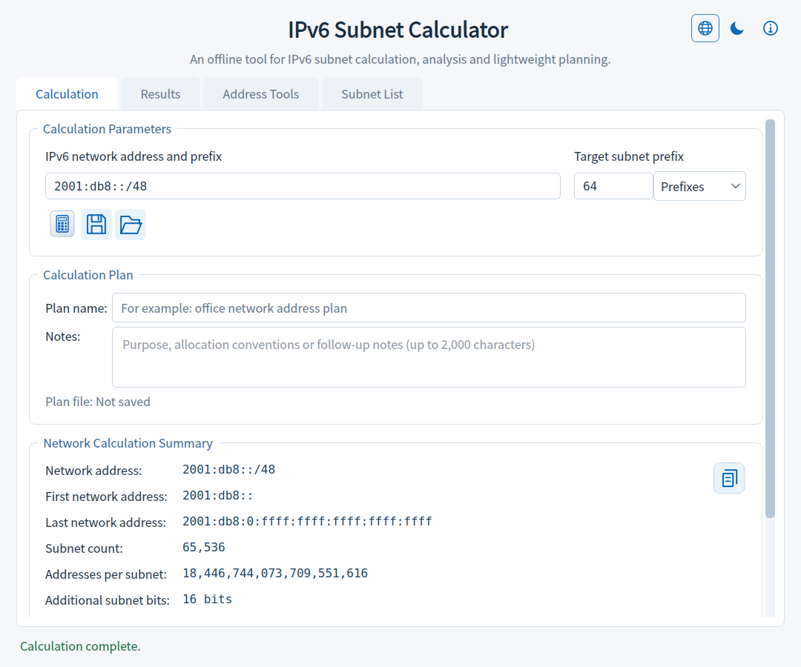
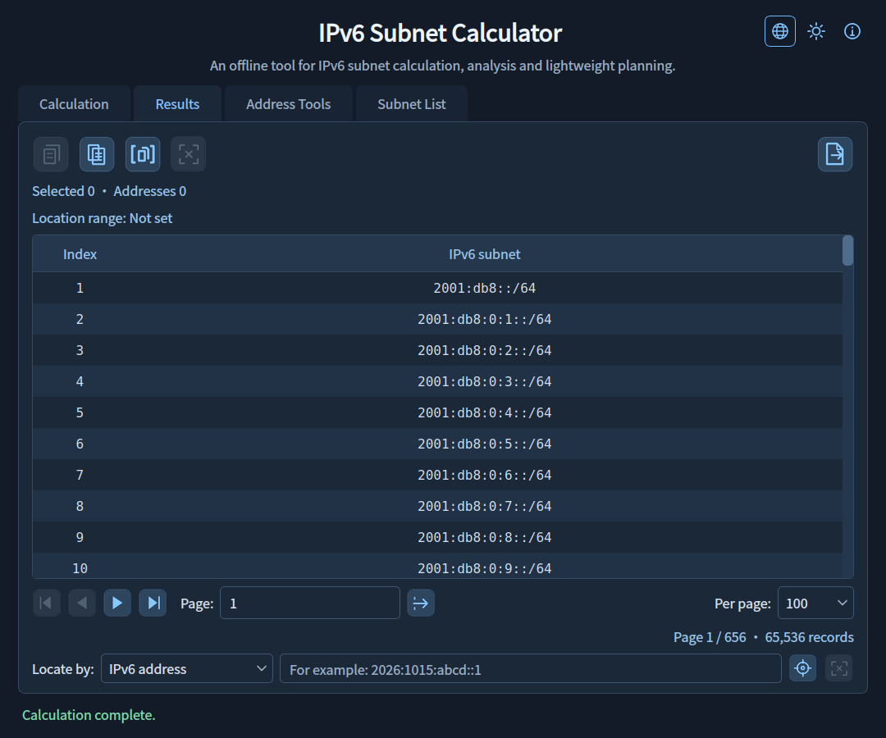
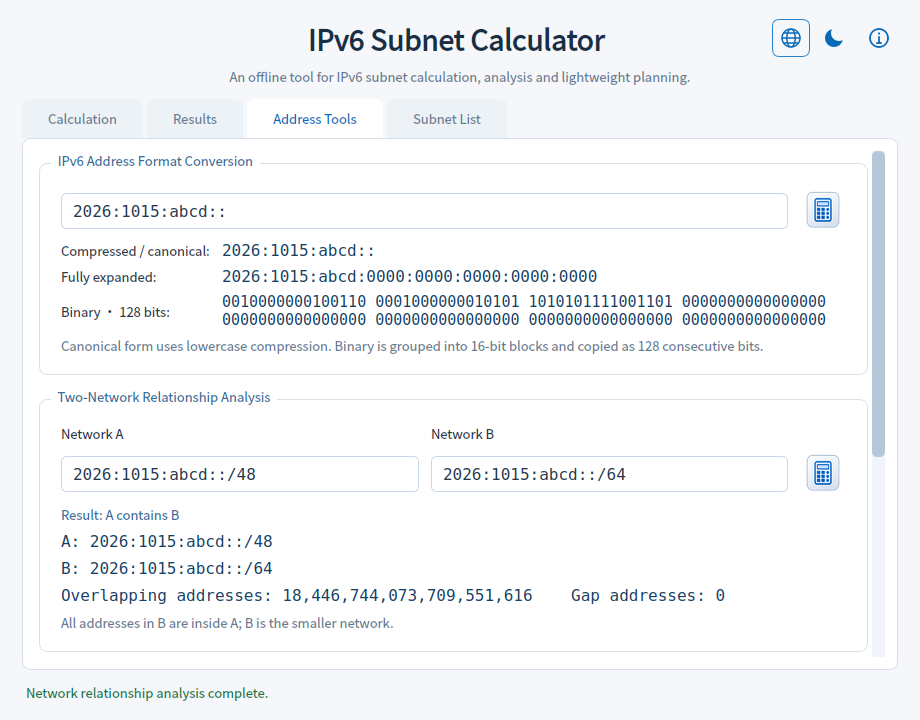
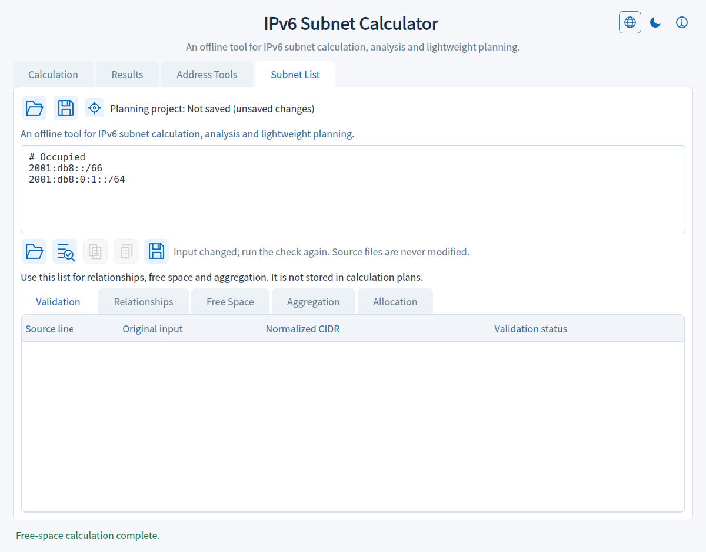
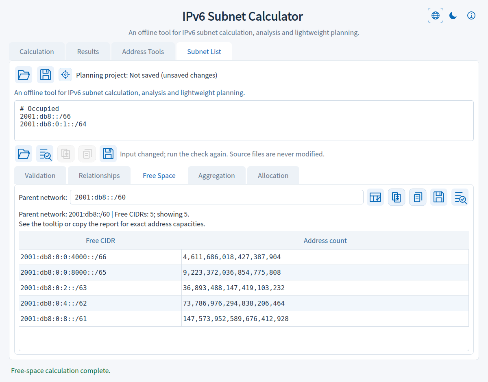
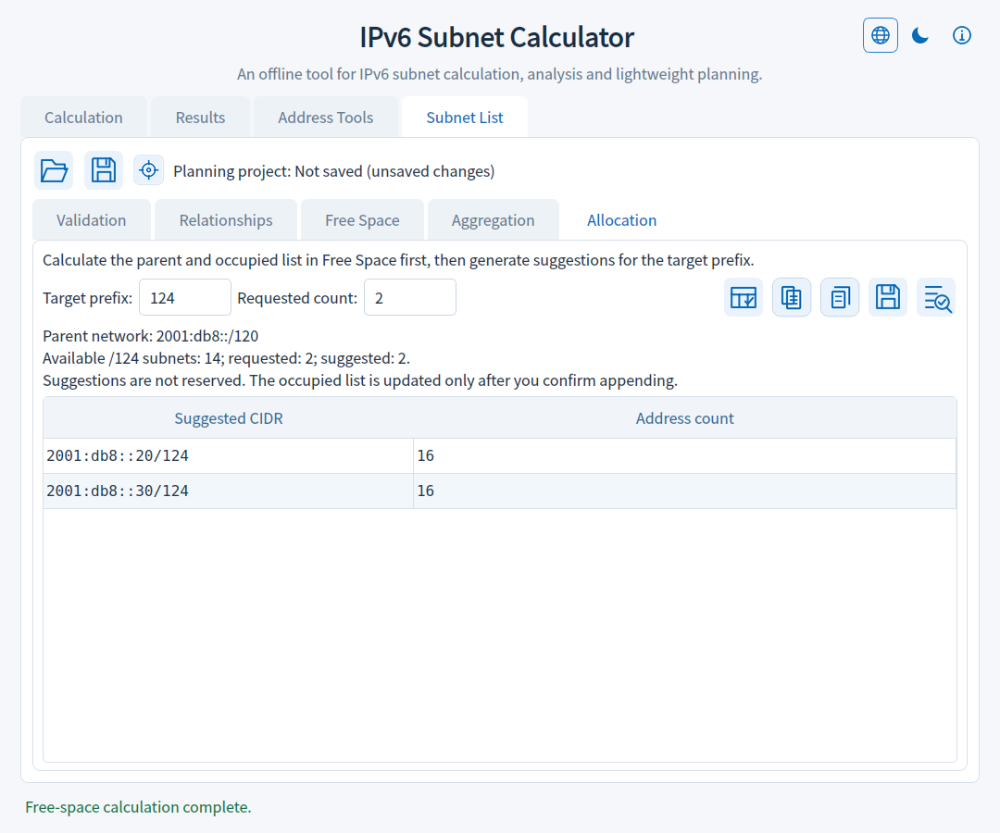
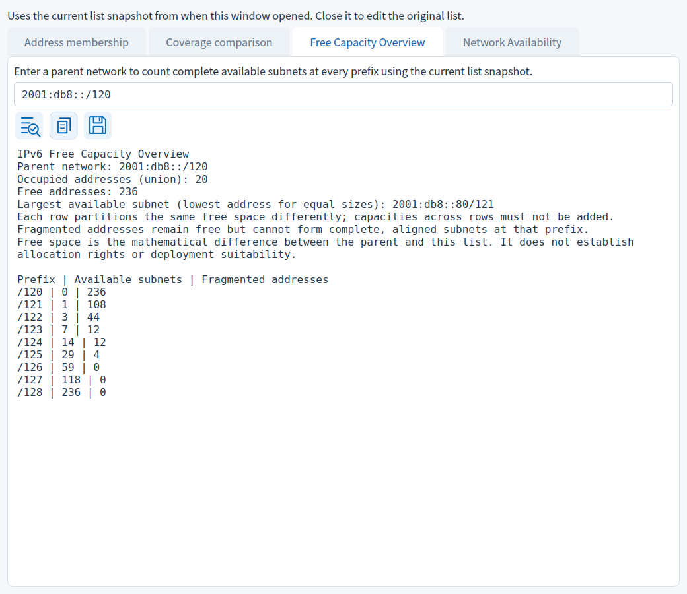

[简体中文](README.md) | **English**

# 🌐 IPv6 Subnet Calculator V1.20

## V1.20 Continuous Candidate Details and Documentation Cleanup

- Batch candidate details add previous/next buttons to browse in input order in the same window, synchronizing the candidate number on the batch page.
- Retains duplicate candidates, physical line numbers, the baseline snapshot and the selected internal CIDR category; boundary buttons are disabled.
- Switching details clears old results and rejects pending saves of the previous candidate, without changing the baseline list or batch results.
- Home pages and About show only the current release. Earlier releases move to Update History, with offline history/return links in About.
- User instructions remain separate from release notes; both languages and matching actual interface screenshots are updated.

[Update History](docs/HISTORY_EN.md)

## 📖 Overview

IPv6SubnetCalculator is an offline IPv6 subnet calculator for Windows. It analyzes network ranges, divides subnets, identifies address usage, and provides Calculation, Results, Address Tools, and Subnet List tabs for subnet operations and address/network analysis.

## ✨ Features

- **Network calculations:** IPv6 CIDR `/0`–`/128`, network ranges, subnet counts, addresses per subnet, and additional subnet bits. Includes common prefix shortcuts, address normalization, and localized input validation messages.
- **Calculation summary copying:** Use the copy icon at the top right of the network summary to copy ranges, source/target prefixes, exact capacities, and address guidance into planning documents.
- **Address guidance:** Classifies ULA, 6to4, multicast, link-local, and other address types, with usage, deployment limitations, and standards references. Mathematical subnetting remains available for special-purpose addresses.
- **Readability:** Larger interface, input, table, detail, and tooltip text, with adjusted table row heights and dialog space.
- **Appearance:** Light and dark themes, switched with the moon/sun icon at the top right or Ctrl+Shift+T. Your preference is remembered.
- **Four tabs:** Calculation contains inputs, summaries, and usage guidance; Results contains the table and actions; Address Tools contains conversion and network relationship analysis; Subnet List validates existing CIDRs and checks batch relationships. Each tab retains its state.
- **Address format conversion:** Compressed/lowercase normalized form, eight-group expanded hexadecimal form, and 128-bit binary, with individual and copy-all actions. Accepts IPv4-mapped IPv6 notation.
- **Two-network analysis:** Classifies two IPv6 CIDRs as equal, A containing B, B containing A, adjacent, or independent. Shows exact overlap and gap address counts and copies a complete report.
- **Pagination and location:** 25, 50, 100, or 200 rows per page; page navigation and lookup by IPv6 address, subnet index, or corresponding ranges. Only the current page is loaded, and locator highlighting persists across pages.
- **Selection and copying:** Current-page counts, first and last indices, continuity, and total address capacity. Copy selected subnets, the current page, an index range, or exact statistics. Supports Ctrl/Shift selection, Ctrl+A, Ctrl+C, and Esc.
- **Subnet details:** Double-click or press Enter to inspect full address ranges and capacity, browse adjacent subnets, and copy details.
- **File export:** Export all subnets or a range to TXT or Excel (XLSX), with size estimates, progress, and cancellation. The destination is replaced only after its temporary file is written successfully. Excel column headers and the worksheet name use the interface language at export start; TXT keeps one CIDR per line.

- **Address range to CIDR**: Convert inclusive first/last IPv6 addresses to minimal CIDRs covering exactly the range, with an exact address count. Copy the list or report, or send it to Subnet List for checking with confirmation before replacing existing input.

## 💾 Calculation Plans

- **Save and restore:** Store the last successful calculation in local JSON. Opening recalculates results and restores page size, page, locator range, current-page selections, and active tab.
- **Names and notes:** Label plans and record their purpose for different networks.
- **Quick actions:** Save/open icons with hover tooltips on Calculation, plus Ctrl+S/Ctrl+O and Ctrl+Shift+S for Save As.
- **Work protection:** Save, discard, or cancel unsaved parameter/name/note changes before opening another plan or closing. Invalid files leave current results intact.
- **Small files:** Store parameters and view state rather than huge subnet lists. Pages and indices use decimal strings to preserve exact integers.

## 📖 About and Offline Help

- **About entry**: a top-bar information icon with a hover tooltip, also opened with F1. Reopening reuses the same window and reading position.
- **Program information**: current application version, capabilities, project license, copyright, acknowledgements and actual runtime component versions.
- **Usage guide**: built-in help for calculation, navigation, selection/copying, plans, address tools, exports and shortcuts.
- **Licenses**: a selector for component notices, project GPL/NOTICE, and original PyQt6, Qt and SIP license texts, available offline.
- **Legal notice**: purpose, deployment responsibility, open-source rights, warranty and liability information consistent with applicable licenses.
- **Reading**: selectable text, a resizable window, synchronized light/dark appearance, and help/license documents embedded in the executable.

## 📋 Subnet List Import and Checks

- **Existing networks**: paste text or import UTF-8 TXT/CIDR files (BOM accepted), one IPv6 CIDR per line. Blank lines and whole-line # comments are ignored.
- **Line validation**: retains original line numbers/input and shows normalized CIDRs, host-bit adjustments and specific errors. Invalid lines are excluded from relationship analysis.
- **Relationships**: exact duplicate, containment and adjacency pair counts. IPv6 CIDR overlap is either equality or containment; adjacency does not guarantee aggregation into one CIDR.
- **Copying**: copy valid normalized CIDRs with duplicates removed in first-occurrence order, or copy a report with errors, exact totals and bounded relationship details. Deduplication neither removes contained subnets nor merges adjacent networks.
- **Bounded processing**: up to 5,000 validation entries, 1 MiB (1,048,576 bytes) and 20,000 physical lines including blanks/comments per check. Background work can be cancelled. Details are limited to 1,000 pairs while totals remain exact.
- **Separate workspace**: list checks preserve calculator results/plans. List input, errors and reports are not stored in calculation plans; copy them to retain the work.

- **Save list text**: Use the save icon to choose original input, valid deduplicated CIDRs or a check report. Original input retains comments and blank lines; reports include error records and exact statistics.

## 🌐 Interface Languages

- **One bilingual application**: Simplified Chinese and English are bundled in one EXE. The upper-right icons are Language → Theme → About; choose a language from the globe menu without restarting or connecting to the Internet.
- **Retain your work**: continue using existing results after switching, with IPv6 inputs, parameters, pagination, selection, location ranges and planning content preserved.
- **Consistent presentation**: pages, tooltips, dialogs, errors, status, table headers and offline help follow the selected language. Background completion uses the current language; the preference is restored at the next launch.
- **Shared plans**: use the same calculation plan in either language, retaining names, notes and original list content.
- **Input experience**: retains JSON plan drops, validated replacement, unsaved-work protection and visible error indicators.

- **File-window language**: Folder/type labels, sizes and dates follow the selected language. The component overview is localized; original license texts are retained.

## 🧮 Free Space and Equivalent CIDR Aggregation

- **Parent-network free space**: treat the list as occupied space within a parent CIDR. Show the occupied union, exact free address count and free CIDRs, without double-counting duplicates or containment.
- **Strict validation**: all occupied entries must be valid and wholly inside the parent. An empty list represents no occupied space.
- **Equivalent aggregation**: remove duplicates/covered subnets and merge only exactly mergeable ranges into a minimal CIDR set with identical coverage. Original input is retained.
- **Copying and reports**: copy complete results or planning reports. Free-CIDR details are capped at 5,000; when truncated, complete-CIDR copying is disabled while reports retain all free address intervals and exact totals.
- **Background and appearance**: both tasks can be cancelled and stale results are cleared on input changes. The About icon now uses transparent theme-aware lines with its tooltip/F1 entry retained.

- **Save and reuse planning results**: Save complete free/aggregated CIDRs or planning reports as TXT, or send complete results back to Subnet List with replacement confirmation. Truncated free-space details still support reports containing all address intervals.

## 🧩 Subnet Allocation Suggestions

- **Capacity by prefix**: Calculate the parent network and occupied list in Subnet List → Free Space, then open Allocation and enter a target prefix and requested count. Capacity counts complete, aligned CIDR blocks rather than dividing total free addresses by block size.
- **Bounded suggestions**: Generate 1–5,000 candidate CIDRs in ascending address order. Requests exceeding capacity produce no partial suggestions. Exact integer counts support the full IPv6 space without enumerating addresses.
- **Copy and save**: Icons copy suggested CIDRs or a capacity report, or save TXT files. Reports use the interface language at save time.
- **Confirmed append**: After confirmation, retain the existing list and comments, append the suggestions as occupied networks and recalculate remaining free space. Cancellation, changed state or list limits preserve existing content.
- **Snapshot protection**: Changing the occupied list, parent, prefix or count invalidates suggestions. Candidates support planning; they do not configure a network or establish authorization.

## 🛡️ Save Conflict Protection

## 📸 English screenshots

## 📦 Download and Usage

Download `IPv6SubnetCalculator_V1.20.exe` directly from Assets on GitHub [Releases](https://github.com/tigerJX95/IPv6SubnetCalculator/releases/latest). Run the downloaded executable; no additional runtime setup is required. Enter a network and target prefix, then click the calculation icon; the application switches to Results when complete.

Press F1 or use the top-bar information icon for built-in help, license texts and legal notices.

For source execution and building, see [Development Notes](docs/DEVELOPMENT.md).

## 💡 Notes

- Editing an Address Tools input clears only that tool's previous results. Click its icon or press Enter to process again; conversion and analysis retain separate states.
- Conversion accepts one IPv6 address without a prefix or zone ID. Compressed and normalized output share a row using lowercase compressed notation. Binary is displayed in 16-bit groups and copied as 128 consecutive bits.
- Network relationships use normalized CIDRs. Adjacent means non-overlapping, directly contiguous ranges; it does not guarantee they form one CIDR. The gap count counts addresses between the two ranges.
- Calculate before saving; edited parameters require recalculation. Plans store calculation state, excluding Address Tools and Subnet List contents and theme preferences.
- Names support up to 80 characters and notes up to 2,000. Saved files include view state, but navigation alone does not trigger unsaved-change prompts.
- The first launch uses the light theme; subsequent launches restore your choice. Hover over the theme icon to see the current theme, next theme, and shortcut. 

- Summary copying uses the last successful calculation shown on the page. Recalculate after editing inputs to update it.
- The default example network is `2026:1015:abcd::/48`.
- IPv6 has no broadcast address; the end address is the last address in the network. Address capacity is a mathematical total, not an assignable host count.
- Manual selection applies only to the current page and clears on page or page-size changes. Switching tabs preserves selection. Locator highlighting is counted separately.
- Changing page size uses the original page's first subnet as the navigation anchor.
- Index-range copying supports up to 5,000 records per operation; use file export for larger ranges.
- One Excel worksheet supports up to 1,048,575 subnet records. If the export includes indices longer than 15 digits, the entire index column is stored as text to preserve every digit.
- Very large statistics use compact display formatting. Hover for full values; copied statistics always contain exact integers.
- Address classification does not imply allocation authorization or public reachability. See the [IANA IPv6 Special-Purpose Address Registry](https://www.iana.org/assignments/iana-ipv6-special-registry).

## 📄 License

Project-authored code and assets are licensed under the **GNU General Public License v3.0 or any later version** (`GPL-3.0-or-later`). See [NOTICE](NOTICE) for the scope and notice, and [LICENSE](LICENSE) for the full terms. Use, modification, and commercial redistribution are permitted subject to the license. This software comes without any warranty.

Third-party components retain their own copyrights and licenses; this project's license declaration does not change them.

## 🙏 Third-Party Components

The interface uses PyQt6 and Qt 6. Copyright, license information, and upstream links are listed in [Third-Party Notices](THIRD_PARTY_NOTICES.md).

[Runtime components and installation source](docs/RUNTIME_DEPENDENCIES.md).
