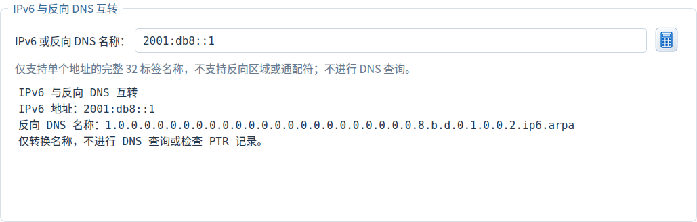
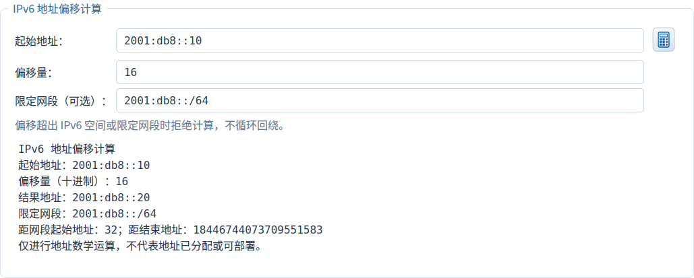

# IPv6 反向 DNS 与地址偏移

[返回首页](../README.md)

在“地址工具”页向下滚动，可找到“IPv6 与反向 DNS 互转”和“IPv6 地址偏移计算”。各工具独立工作，不修改计算方案、清单、网络配置或 DNS 记录。每个输入框均可按 Enter，也可点击计算图标。

## IPv6 与反向 DNS 互转

| 设置／操作 | 含义 | 示例 |
|---|---|---|
| IPv6 或反向 DNS 名称 | 输入单个 IPv6 地址，或 32 个单字符十六进制标签构成的完整 ip6.arpa 名称 | `2001:db8::1` |
| 计算图标／Enter | 自动识别转换方向，输出规范化 IPv6 与反向名称 | 粘贴反向名称可还原原地址 |
| 右键 → 复制反向 DNS 名称 | 只复制规范化的小写名称，输出不带末尾根点 | 用于 PTR 名称核对 |
| 右键 → 复制 IPv6 地址 | 只复制对应的 IPv6 地址 | `2001:db8::1` |
| 右键 → 复制完整工具报告 | 复制地址、反向名称及操作边界说明 | 放入规划记录 |

例如 `::1` 转换后得到 `1.` 加上 31 个 `0.`，最后为 `ip6.arpa`；把完整名称粘回输入框，可还原 `::1`。接受大写标签和单个末尾根点；不接受反向区域前缀、通配符、URL、IPv4 或含 `%` 区域标识的地址。映射 IPv6 地址按完整 128 位转换。规则参考 [RFC 3596 §2.5](https://www.rfc-editor.org/rfc/rfc3596.html#section-2.5)。

该功能仅转换地址与名称，不查找主机名、不联网、不验证 PTR 是否存在，也不创建记录。输入改变立即清除旧报告并禁用结果复制；非法输入会提示具体位置，改正后重新转换。

## IPv6 地址偏移计算

| 设置／操作 | 含义 | 示例 |
|---|---|---|
| 起始地址 | 单个 IPv6 地址，不含 CIDR 或区域标识 | `2001:db8::10` |
| 偏移量 | 十进制整数，可带 `+` 或 `-`，最多 39 位数字；不接受十六进制、小数或指数 | `16`、`-1`、`0` |
| 限定网段（可选） | 留空允许整个 IPv6 空间；填写 CIDR 后，起始和结果地址都须位于其中，主机位自动规范化 | `2001:db8::/64` |
| 计算图标／Enter | 按 128 位整数运算，显示结果；限定网段时附距网段首末地址的距离 | `::ffff + 1` → `::1:0` |
| 右键 → 复制结果地址 | 只复制计算后的 IPv6 地址 | `2001:db8::20` |
| 右键 → 复制完整工具报告 | 包含起始地址、十进制偏移、结果和可选网段／距离 | 保存规划过程 |

默认示例为 `2001:db8::10` 加十进制 `16`，结果 `2001:db8::20`。使用 `-1` 得 `2001:db8::f`，使用 `0` 保持地址不变。限定 `::/126` 时，`::1 + 1` 得 `::2`，距网段起始 2、距结束 1；`::3 + 1` 超出限定网段，会拒绝。`:: - 1` 和最大 IPv6 地址加 1 也会拒绝，不循环回绕。

输入改变立即清空旧结果，重新计算后才能复制。结果和报告跟随界面语言，语言切换保留输入和当前结果；数学结果不代表已获分配或可直接部署。两个工具均可在浅／深主题下使用；内容超出窗口时通过页面滚动浏览。

