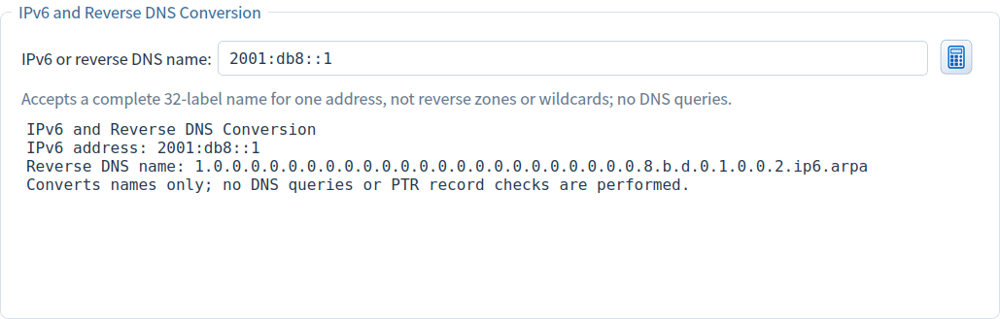
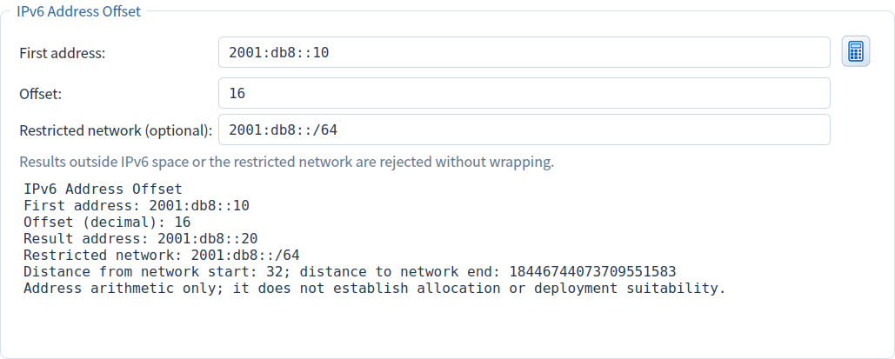

# IPv6 Reverse DNS and Address Offsets

[Home](../README_EN.md)

Scroll down in Address Tools to find IPv6 and Reverse DNS Conversion and IPv6 Address Offset. Tools work independently and do not modify calculation plans, lists, network settings or DNS records. Press Enter in any input or click its calculation icon.

## IPv6 and Reverse DNS Conversion

| Setting / action | Meaning | Example |
|---|---|---|
| IPv6 or reverse DNS name | One IPv6 address or a complete ip6.arpa name with 32 single hexadecimal labels | `2001:db8::1` |
| Calculate / Enter | Detect the conversion direction and show a normalized address and name | Paste the name to recover the address |
| Right-click → Copy reverse DNS name | Copy the normalized lowercase name without a trailing root dot | Check a PTR owner name |
| Right-click → Copy IPv6 address | Copy only the corresponding address | `2001:db8::1` |
| Right-click → Copy complete tool report | Copy the address, name and operating boundaries | Keep a planning record |

For example, `::1` produces `1.` followed by 31 instances of `0.` and then `ip6.arpa`. Pasting the complete name back restores `::1`. Uppercase labels and a single trailing root dot are accepted. Reverse zones, wildcards, URLs, IPv4 addresses and scoped addresses containing `%` are rejected. Mapped IPv6 addresses use all 128 bits. See [RFC 3596 §2.5](https://www.rfc-editor.org/rfc/rfc3596.html#section-2.5).

This converts addresses and names only. It does not look up hostnames, contact DNS, verify PTR existence or create records. Editing clears the previous report and disables result copying; correct invalid input and convert again.

## IPv6 Address Offset

| Setting / action | Meaning | Example |
|---|---|---|
| Starting address | A single IPv6 address without CIDR or a scope identifier | `2001:db8::10` |
| Offset | Decimal integer, optional `+` or `-`, at most 39 digits; no hexadecimal, fractions or exponent notation | `16`, `-1`, `0` |
| Restricted network (optional) | Blank allows all IPv6 space; a CIDR requires both input and output inside it. Host bits are normalized | `2001:db8::/64` |
| Calculate / Enter | Use exact 128-bit arithmetic; restricted results also show distances from the first and last network addresses | `::ffff + 1` → `::1:0` |
| Right-click → Copy result address | Copy only the resulting IPv6 address | `2001:db8::20` |
| Right-click → Copy complete tool report | Include input, decimal offset, result and optional network/distances | Keep the planning calculation |

The default `2001:db8::10` plus decimal `16` gives `2001:db8::20`. An offset of `-1` gives `2001:db8::f`; zero keeps the same address. Within `::/126`, `::1 + 1` gives `::2`, two addresses from the start and one from the end. `::3 + 1` is rejected as outside that network. `:: - 1` and the maximum IPv6 address plus 1 are rejected without wrapping.

Editing clears old results and disables copying until recalculation. Reports follow the interface language; switching language preserves input and results. Mathematical results do not prove allocation or deployment suitability. Both tools support light/dark themes and remain reachable by scrolling when the page exceeds the window.

