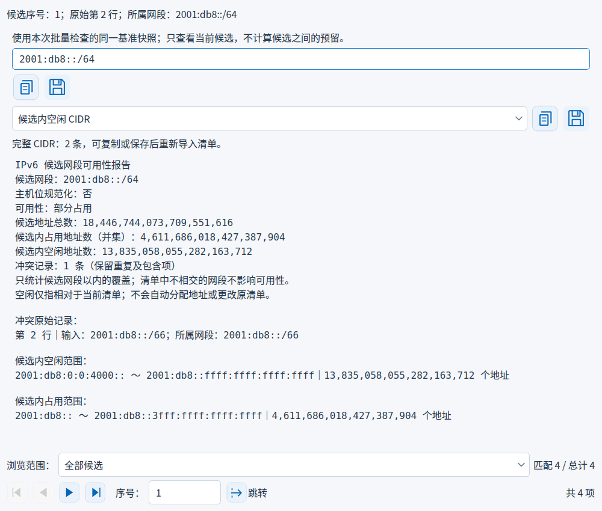
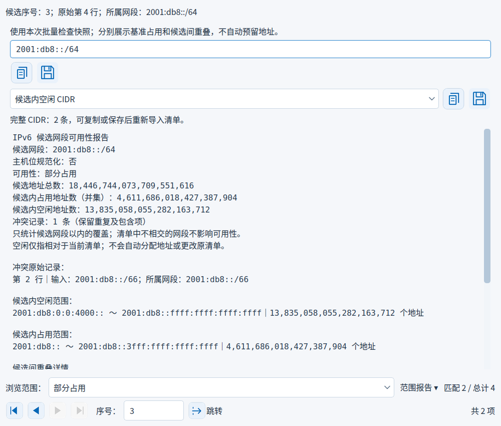
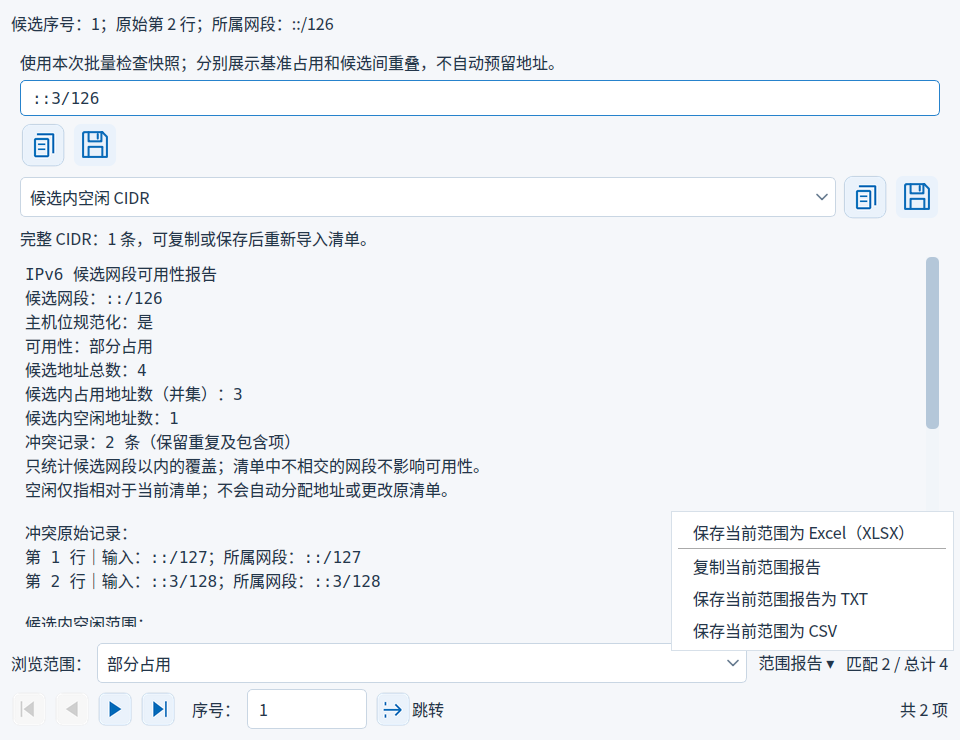
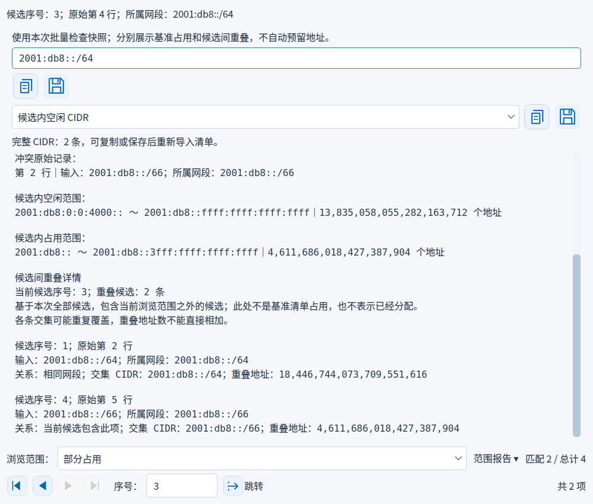

[English](BATCH_DETAILS_EN.md) | [返回首页](../README.md)

# 批量候选详情

## 批量候选详情

批量检查成功后，在报告上方选择“候选序号（按输入顺序）”，点击右侧定位图标。序号从 1 开始，仅按有效候选计数；空行和注释不计入序号，重复候选仍各占一项。详情顶部显示候选序号、原始物理行号和所属网段，输入框保留原文且只读。

详情沿用本次批量检查的同一基准快照，报告列出所有相交基准记录的原始行号（保留重复与包含项），并显示精确空闲／占用范围。下方选择“候选内空闲 CIDR”或“候选内占用 CIDR”后可复制、保存内部片段；这与批量页输出完整候选网段不同。空结果或超过 5,000 条时禁止纯 CIDR 输出，完整范围报告仍可保存。

例如基准为 `::/127` 与 `::3/128`，候选为 `::3/126`：所属网段为 `::/126`，占用 3 个地址，空闲为 `::2/128`；选择占用 CIDR 得到 `::/127` 与 `::3/128`。复制并不会更改基准清单。

切换候选序号、修改批量输入或关闭查询窗口会关闭并清空旧详情；保存对话框期间发生这些变化会拒绝保存旧结果。详情关闭或 Esc 返回不影响原批量结果，重新点击图标可再次查看。需要刷新基准时关闭查询窗口后重开。

## 设置项与操作

| 项目 | 用途与边界 | 示例 |
|---|---|---|
| 候选序号 | 1～本次候选数，按输入顺序，最多 5,000；重复项保留 | 第 3 项可以与第 1 项相同 |
| 定位图标 | 按需打开所选候选详情，未成功检查时禁用 | 选择 1 后点击 |
| 原始行号 | 候选输入中的物理行，包含注释和空行 | 两行注释后首个候选为第 3 行 |
| 只读输入 | 保留主机位与原文；所属网段另行显示 | `::3/126` → 所属网段 `::/126` |
| 报告复制／保存 | 输出单候选可用性报告、基准冲突原始行及完整范围 | 保存 `IPv6_NetworkAvailability.txt` |
| CIDR 类别 | 仅选择候选内部空闲或占用的片段 | 空闲 `::2/128` |
| CIDR 复制／保存 | 输出所选类别完整且最简的 CIDR，空或截断时禁用 | 保存 `IPv6_available_CIDRs.txt` |
| 上一项／下一项 | 在同一详情窗口浏览，首末项禁用；保留 CIDR 类别并同步批量页序号 | 第 1 项点击下一项进入第 2 项 |
| 首项／末项 | 底部跳转到当前范围第一个或最后一个候选，两端按钮按边界禁用 | 末项跳到第 5,000 项 |
| 序号与跳转 | 输入 1～总数后按 Enter 或点击跳转；无效值保留当前报告 | 输入 3 跳到第 3 项 |
| 总数 | 右侧显示本次候选条数，重复项分别计数 | 共 3 项 |
| 浏览范围 | 按状态筛选详情；保留原始序号，切换后重核保存 | 部分占用可浏览原始第 1、3 项 |
| 匹配／总计 | 按原始记录计数，包含重复候选 | 匹配 2 / 总计 4 |
| 范围报告菜单 | 复制或保存当前范围内全部匹配项，空范围禁用 | 部分占用范围输出原始第 1、3 项 |
| 候选间重叠详情 | 报告内列出全部候选中的重叠来源与精确交集，包含筛选范围外的项 | 第 1 项与第 2、3 项相交 |
| 关闭／Esc | 返回批量结果，不修改清单或候选 | 重新点击定位图标再次查看 |

详情分别展示基准占用和候选间重叠来源；候选间重叠条数也见批量报告。详情只按需分析一条候选，不预先存储全部候选与基准的交叉明细。

批量页的 CIDR 输出类别不会筛选详情序号；详情的浏览范围独立设置；选择“全部候选”时可按输入顺序查看本次全部候选。

详情底部固定导航栏中的“查看上一个候选详情”“查看下一个候选详情”图标可在同一窗口连续浏览，并同步批量页序号；到达第一项或最后一项时对应按钮禁用。切换时保留所选空闲／占用 CIDR 类别，但清除旧报告后重新生成当前候选详情。重复候选仍是独立项；保存期间切换候选会中止旧保存。例如候选为 `::3/126`、`::4/126`、`::3/126`，从第 1 项点击下一项到第 2 项，再点击下一项到第 3 项，重复项的原始行号仍分别保留。

底部导航与“子网结果”使用相同的图标样式：首项／末项可直接到达两端；序号框输入 1～当前候选总数后按 Enter 或点击跳转图标。例如输入 `3` 跳至第 3 项，右侧显示总数。无效或越界序号会在输入框提示，当前报告保留。导航栏固定在报告下方，不随报告滚动。

## 按状态浏览候选详情

详情报告下方的“浏览范围”控制详情浏览及范围报告，可选全部候选、全部空闲、部分占用、全部占用、存在占用冲突（含部分占用和全部占用）。首项、上一项、下一项、末项在匹配项之间移动，仍保留原始候选序号和重复项。切换范围时，若当前候选仍匹配则保留位置，否则显示第一个匹配项。右侧“匹配／总计”按候选记录计数；底部总数是当前范围的匹配条数。

例如基准清单为 `::/127` 与 `::3/128`，候选依次为 `::3/126`、`::4/126`、`::3/126`、`::/127`。选择“部分占用”后只浏览原始第 1、3 项；点击下一项从 1 跳到 3。选择“存在占用冲突”可浏览第 1、3、4 项。

序号框仍输入原始候选序号，点击“跳转”或按 Enter；例如在“部分占用”范围内输入 `3` 可跳转，输入 `2` 会提示不在当前范围，并保留现有报告。跳转到未匹配项时可先选择“全部候选”。空范围会清空旧输入与报告，禁用导航、跳转及报告／CIDR 输出；可切换其他范围恢复。切换范围期间已打开的保存操作会拒绝旧输出，即使当前候选仍匹配。

范围选择不修改基准清单、候选输入、完整批量报告、批量页 CIDR 输出类别或详情内空闲／占用类别。查询窗口仍使用打开时的基准快照；重新打开候选详情默认浏览全部候选。

## 复制和保存当前范围报告

在候选详情底部选择“浏览范围”，点击旁边“范围报告”菜单，选择“复制当前范围报告”或“保存当前范围报告为 TXT”。输出范围内所有匹配候选，保留原始序号、物理行号、重复项、输入、规范化网段、状态、精确占用／空闲地址数，以及本次全部候选中的重叠记录条数。

例如基准为 `::/127` 与 `::3/128`，候选依次为 `::3/126`、`::4/126`、`::3/126`、`::/127`。选择“部分占用”并复制范围报告，会包含原始第 1、3 项，重复候选各自保留；报告显示匹配 2 条、原始总数 4 条。“全部候选”可输出这 4 项。若第 1 条候选前有注释行，其物理行号仍按输入文本计算。

范围报告覆盖当前范围全部匹配项；详情上方已有的报告复制／保存仍用于当前单个候选。批量页完整报告和 CIDR 输出类别保持独立。报告使用复制或实际保存时的语言，用户原始输入保留原文。无匹配项时菜单禁用，不生成空文件。

同一范围内前后浏览允许继续保存整份范围报告。保存文件选择或覆盖确认期间切换范围、改动候选输入或关闭详情窗口，会中止旧报告保存；切换到其他范围再切回也会中止。取消保存保留当前工作，目标文件沿用覆盖确认和保存冲突保护。

## 查看候选间重叠来源

打开候选详情后，在报告中向下滚动到“候选间重叠详情”。这里列出与当前候选相交的其他候选原始序号、物理行号、原始输入、规范化网段、相同／包含关系、交集 CIDR 和精确地址数。当前条目自身不计入；相同网段的其他重复条目仍各占一条，相邻但不相交的网段不计入。

例如候选依次为 `::3/126`、`::/127`、`::3/126`、`::4/126`。查看第 1 项时，所属网段是 `::/126`：第 2 项被它包含，交集 `::/127`，重叠 2 个地址；第 3 项与它相同，交集 `::/126`，重叠 4 个地址；第 4 项仅相邻，不列入。各条交集可能重复，地址数不能直接相加。

此处按本次全部候选查询，因此“部分占用”浏览范围以外的候选也可能列入。候选间重叠与基准清单占用分别展示：即使当前候选对基准全部空闲，也可能与其他候选冲突。查询只分析当前项，不预存全部候选的两两明细，也不自动为任何候选预留地址。

详情上方的报告复制／保存会包含基准可用性与候选间重叠两部分；下方空闲／占用 CIDR 按钮仍输出相对于基准清单的内部片段。“范围报告”输出所选范围的逐项摘要和原有重叠条数。切换候选、清空筛选范围、修改候选输入或关闭窗口时清除旧重叠详情，拒绝已失效的完整报告保存。

## 当前范围导出 CSV

在“子网清单 → 查询 → 批量候选”完成检查，打开候选详情，选择“浏览范围”，在“范围报告”菜单点击“保存当前范围为 CSV”。默认文件名为 `IPv6_BatchRange_<范围键>.csv`，未填扩展名时自动补上 `.csv`，不接受其他扩展名。没有匹配候选时禁用。

CSV 每条候选占一条数据记录，列依次为：候选序号、原始行号、原始输入、规范化网段、可用性、占用地址数、空闲地址数、重叠候选记录数（全部候选）、主机位规范化。序号从 1 开始，物理行号包含空行和注释；保持输入顺序和重复项。重叠记录数仍对照全部候选，不能只按当前筛选范围解释。文件不追加汇总行，避免把汇总误当候选。

例如基准为 `::/127` 和 `::3/128`，候选为 `::3/126`、`::4/126`、`::3/126`、`::/127`。选择“部分占用”后导出，得到原始第 1、3 项；两条均为规范化网段 `::/126`、占用 3、空闲 1、重叠候选记录 2，主机位规范化为“是”。若前面有注释和空行，CSV 原始行号相应增加。

文件为带 BOM 的 UTF-8，使用标准引号、逗号分隔及 CRLF 换行。表头、状态、是／否使用实际保存时的语言，原始输入保持原样。地址数以完整十进制数字写入，**CSV 引号不保证 Excel 按文本读取**：请在 Excel 用“数据 → 从文本/CSV”导入，将占用／空闲地址数列设为“文本”后加载。例如空基准下 `::/0` 的空闲数为 `340282366920938463463374607431768211456`；直接双击 CSV 可能被 Excel 自动舍入。候选可能互相重叠，不能将地址数直接相加当作可分配总量。

保存沿用覆盖确认和文件冲突保护。文件选择或覆盖确认期间切换浏览范围（包括切回）、编辑候选或关闭详情，将中止旧输出；同一范围内前后导航仍允许保存。原 TXT 报告、CIDR 输出和清单内容保持独立。

[CSV 示例](../examples/batch_range_zh_CN.csv)

## 当前范围导出 Excel（XLSX）

在候选详情中选择“浏览范围”，点击“范围报告 → 保存当前范围为 Excel（XLSX）”。默认文件名 `IPv6_BatchRange_<范围键>.xlsx`，未填写扩展名时补上 `.xlsx`，其他扩展名会提示重选。无匹配候选时禁用。

Excel 与 CSV 输出相同的九列和全部匹配记录，保留输入顺序、原始候选序号、物理行号及重复项；工作表名、表头、状态及是／否使用实际保存时的界面语言。首行冻结，表头可筛选，设定适合 CIDR 和完整数量的列宽并自动换行。

占用地址数与空闲地址数整列明确保存为文本，**直接打开 XLSX 即可保留完整精度，不需要像 CSV 那样另行设置文本导入**。原始序号、原始行号及重叠候选记录数为可排序的数值，IPv6 和原始输入为文本。此表用于查看／筛选，不提供地址数求和公式；重叠候选的地址数不能直接相加。

例如空基准下检查候选 `::/0`，选择“全部候选”后导出，空闲地址数单元格完整显示 `340282366920938463463374607431768211456`。使用前文“部分占用”示例时，Excel 只包含原始第 1、3 项，重复项不合并。与 CSV／TXT 一样，取消、切换范围（含切回）、编辑候选或关闭窗口会拒绝旧保存；覆盖前确认，文件被其他程序修改时保留对方内容。
