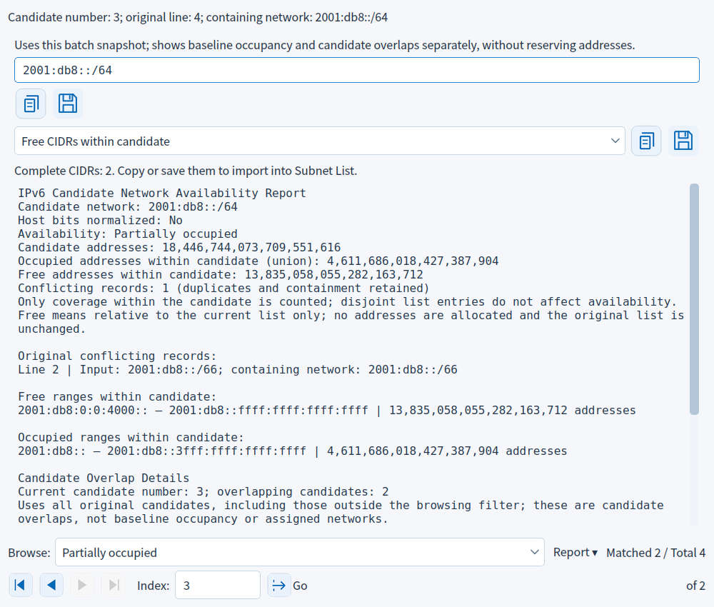
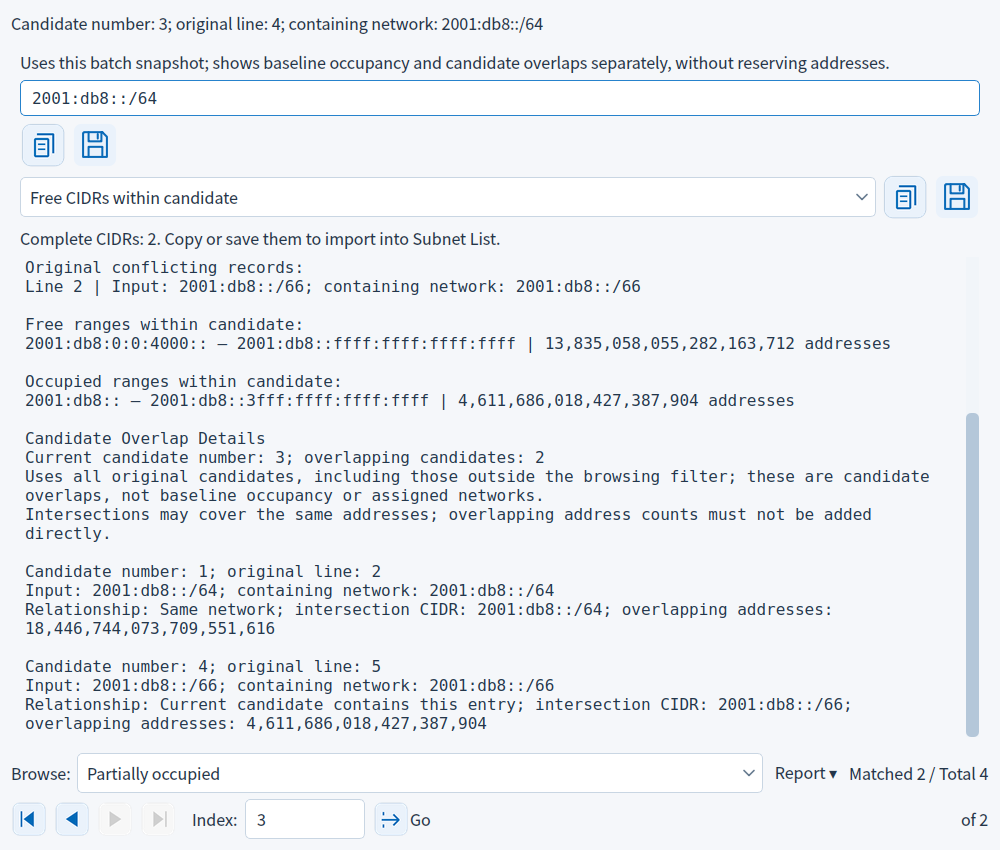

[简体中文](BATCH_DETAILS.md) | [Home](../README_EN.md)

# Batch Candidate Details

## Batch candidate details

After a successful batch check, choose a Candidate number (input order) above the report and click the adjacent locate icon. Numbers start at 1 and count valid candidates, excluding blank/comment lines; duplicate candidates remain separate. Details show the candidate number, original physical line number and containing network. The original input is read-only.

Details use the same baseline snapshot. Reports retain all intersecting baseline records and their original source lines, including duplicates and containment, plus exact free/occupied ranges. Choose Free CIDRs inside candidate or Occupied CIDRs inside candidate to copy/save internal fragments, unlike the batch page's whole candidate output. Empty or over-5,000 CIDR outputs are disabled; the complete range report remains available.

Example: baseline `::/127` and `::3/128`, candidate `::3/126`. Its containing network is `::/126`, three addresses are occupied and the free CIDR is `::2/128`. Occupied CIDRs are `::/127` and `::3/128`. Copying does not change the baseline.

Changing candidate number, editing batch input or closing inspection clears old details and rejects pending stale saves. Closing details or pressing Esc preserves batch results; reopen with the icon. Close and reopen inspection to refresh its baseline snapshot.

## Settings and actions

| Item | Purpose and limits | Example |
|---|---|---|
| Candidate number | 1 through the checked candidate count, up to 5,000; input order and duplicates retained | Item 3 may equal item 1 |
| Locate icon | Opens details on demand; disabled before a successful batch check | Choose 1, then click |
| Original line | Physical line in candidate input, counting comments and blanks | First candidate after two comment lines is line 3 |
| Read-only input | Retains original text and host bits; normalized network is shown separately | `::3/126` belongs to `::/126` |
| Report copy/save | Single-candidate report, original baseline conflict lines and complete ranges | Save `IPv6_NetworkAvailability.txt` |
| CIDR category | Free or occupied fragments inside the candidate | Free: `::2/128` |
| CIDR copy/save | Complete minimal CIDRs for that category; disabled if empty or truncated | Save `IPv6_available_CIDRs.txt` |
| Previous / Next | Browse in one window; boundaries disabled; retain CIDR category and synchronize the batch index | Next moves item 1 to item 2 |
| First / Last | Bottom buttons go directly to either filtered boundary, disabled at that boundary | Last goes to item 5,000 |
| Index and Go | Enter 1 through the total and press Enter or click Go; invalid input preserves the report | Enter 3 for item 3 |
| Total count | Counts all checked candidates, including duplicates | of 3 |
| Browse filter | Filters details by status, retaining original indices and invalidating pending saves | Partial matches original items 1 and 3 |
| Matched / Total | Counts original records, including duplicate candidates | Matched 2 / Total 4 |
| Report menu | Copy/save every match in the current range; disabled when empty | Partial filter reports original items 1 and 3 |
| Candidate overlap details | Report section lists overlap sources and exact intersections across all candidates, including outside the filter | Item 1 overlaps items 2 and 3 |
| Close/Esc | Return without changing input or the baseline | Reopen with the locate icon |

Details show both baseline conflicts and candidate overlap sources. Candidate overlap counts also remain in the batch report. Only one candidate is analyzed on demand; no all-candidate cross-product detail cache is built.

The batch CIDR output category does not filter candidate numbers in the detail selector; the detail browsing filter is independent. Choose All candidates to browse every checked entry in input order.

Use the Previous candidate details / Next candidate details icons in the fixed bottom navigation bar to browse in the same window and synchronize the batch-page index. The corresponding button is disabled at either boundary. Switching retains the free/occupied CIDR category, clears the old report and computes details for the current candidate. Duplicate candidates remain separate items, and switching during a save rejects the old output. For example, with `::3/126`, `::4/126`, `::3/126`, Next moves from item 1 to item 2 and then item 3, preserving the distinct physical lines of the duplicate entries.

The bottom bar uses the same icon style as Subnet Results. First/Last moves to either boundary. Enter an index from 1 through the candidate count, then press Enter or click Go. For example, `3` opens item 3; the total count appears on the right. Invalid or out-of-range input is marked without changing the report. The bar stays below the report and does not scroll with it.

## Browse candidate details by status

The Browse selector below the report controls detail navigation and range reports: all candidates, entirely free, partly occupied, fully occupied or any occupied overlap (partial or full). First/Previous/Next/Last moves between matching entries while preserving original candidate numbers and duplicates. Changing the filter keeps the current candidate when it still matches; otherwise it shows the first match. Matched/Total counts candidate records; the bottom count is the number matching this filter.

Example: baseline `::/127` and `::3/128`; candidates in order `::3/126`, `::4/126`, `::3/126`, `::/127`. Partly occupied matches original items 1 and 3: Next moves from 1 to 3. Any occupied overlap matches 1, 3 and 4.

The index field takes the original candidate number. Click Go or press Enter. In the partial filter, `3` opens item 3; `2` is rejected without changing the report. Select All candidates to reach a nonmatching entry. An empty filter clears old input/reports and disables navigation, jumps and report/CIDR output; another filter restores browsing. A filter change rejects pending saves of old details, even when the current candidate still matches.

Browsing filters do not alter the baseline, candidate input, full batch report, batch CIDR output category or internal free/occupied CIDR category. Inspection still uses the baseline snapshot from when the window opened. Reopening details defaults to All candidates.

## Copy and save the current range report

Choose Browse at the bottom of candidate details, then use Report → Copy current range report or Save current range report as TXT. The report contains all matching candidates, with original indices, physical source lines, duplicates, input, normalized networks, status, exact occupied/free address counts and overlap counts from all original candidates.

Example: baseline `::/127` and `::3/128`; candidates `::3/126`, `::4/126`, `::3/126`, `::/127`. Select Partially occupied and copy the range report. It contains original items 1 and 3, keeping both duplicate records, and shows two matches out of four original candidates. All candidates outputs all four. Comments and blank lines still count toward physical source line numbers.

The range report includes every match. The existing report copy/save controls above it still operate on the current single candidate. The full batch report and batch CIDR output category remain independent. Reports use the language at copy time or actual save time; original user input is preserved. Empty filters disable the menu and never create empty files.

Navigation within the same range does not invalidate saving the complete range report. Changing the filter, editing candidate input or closing details during file selection or overwrite confirmation cancels the old save. Changing away and back to the same filter also cancels it. Cancellation preserves current work; overwrite confirmation and save conflict protection apply.

## Inspect candidate overlap sources

Open candidate details and scroll down to Candidate Overlap Details. It lists other overlapping candidates with their original numbers, physical source lines, original input, normalized networks, equality/containment relationships, intersection CIDRs and exact address counts. The current record is excluded; other duplicate records remain separate. Adjacent disjoint networks are excluded.

Example candidates: `::3/126`, `::/127`, `::3/126`, `::4/126`. Item 1 normalizes to `::/126`: it contains item 2, with intersection `::/127` and two addresses; item 3 is equal, with intersection `::/126` and four addresses. Item 4 is adjacent and is not listed. Intersections may cover the same addresses and their counts must not be added directly.

Sources use all candidates from the batch, including entries outside the browsing filter. Candidate overlaps and baseline occupancy are shown separately: a candidate entirely free against the baseline can still overlap another candidate. Only the current item is analyzed on demand; no all-pairs detail matrix or candidate reservations are created.

The existing detail report copy/save controls include both baseline availability and candidate overlaps. Internal free/occupied CIDR controls still output fragments relative to the baseline. The Report menu outputs the selected range’s record summaries and original overlap counts. Navigation, empty filters, candidate edits and closure clear old overlap evidence and reject stale complete-report saves.

