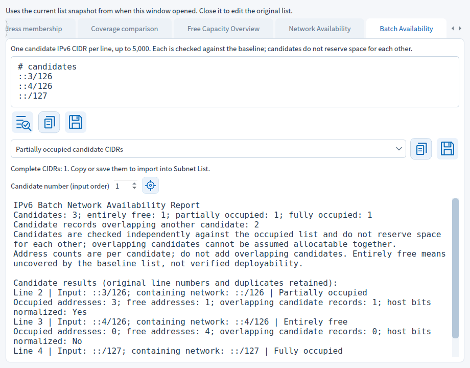
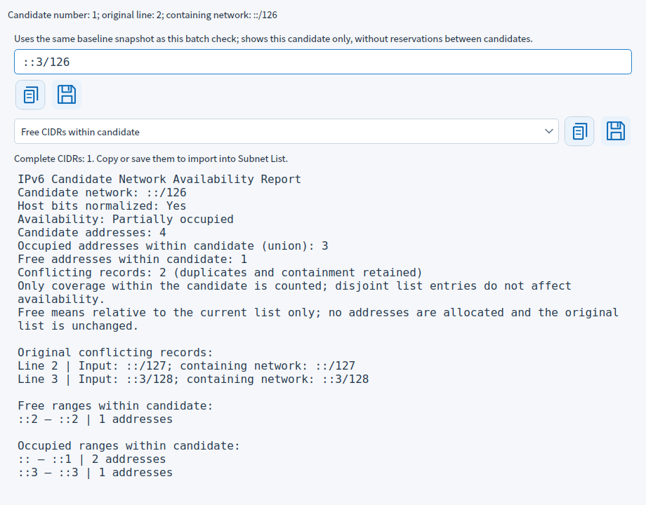

[简体中文](BATCH_DETAILS.md) | [Home](../README_EN.md)

# Batch Candidate Details

## Batch candidate details

After a successful batch check, choose a Candidate number (input order) above the report and click the adjacent locate icon. Numbers start at 1 and count valid candidates, excluding blank/comment lines; duplicate candidates remain separate. Details show the candidate number, original physical line number and containing network. The original input is read-only.

Details use the same baseline snapshot. Reports retain all intersecting baseline records and their original source lines, including duplicates and containment, plus exact free/occupied ranges. Choose Free CIDRs inside candidate or Occupied CIDRs inside candidate to copy/save internal fragments, unlike the batch page's whole candidate output. Empty or over-5,000 CIDR outputs are disabled; the complete range report remains available.

Example: baseline `::/127` and `::3/128`, candidate `::3/126`. Its containing network is `::/126`, three addresses are occupied and the free CIDR is `::2/128`. Occupied CIDRs are `::/127` and `::3/128`. Copying does not change the baseline.

Changing candidate number, editing batch input or closing inspection clears old details and rejects pending stale saves. Closing details or pressing Esc preserves batch results; reopen with the icon. Close and reopen inspection to refresh its baseline snapshot.

## Settings and actions

| Item | Purpose and limits | Example |
|---|---|---|
| Candidate number | 1 through the checked candidate count, up to 5,000; input order and duplicates retained | Item 3 may equal item 1 |
| Locate icon | Opens details on demand; disabled before a successful batch check | Choose 1, then click |
| Original line | Physical line in candidate input, counting comments and blanks | First candidate after two comment lines is line 3 |
| Read-only input | Retains original text and host bits; normalized network is shown separately | `::3/126` belongs to `::/126` |
| Report copy/save | Single-candidate report, original baseline conflict lines and complete ranges | Save `IPv6_NetworkAvailability.txt` |
| CIDR category | Free or occupied fragments inside the candidate | Free: `::2/128` |
| CIDR copy/save | Complete minimal CIDRs for that category; disabled if empty or truncated | Save `IPv6_available_CIDRs.txt` |
| Close/Esc | Return without changing input or the baseline | Reopen with the locate icon |

Details explain conflicts with the baseline, not conflicts between candidates or real deployment status. Candidate overlap counts remain in the batch report. Only one candidate is analyzed on demand; no all-candidate cross-product detail cache is built.

The batch CIDR output category does not filter candidate numbers in the detail selector; all checked candidates remain available in input order.
