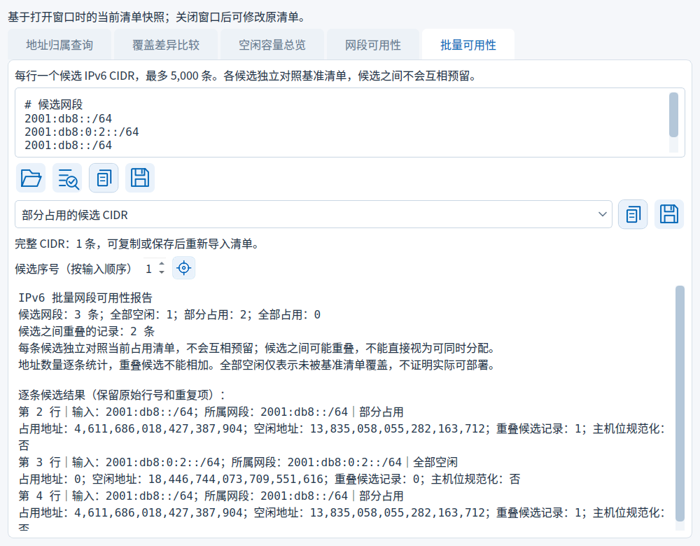
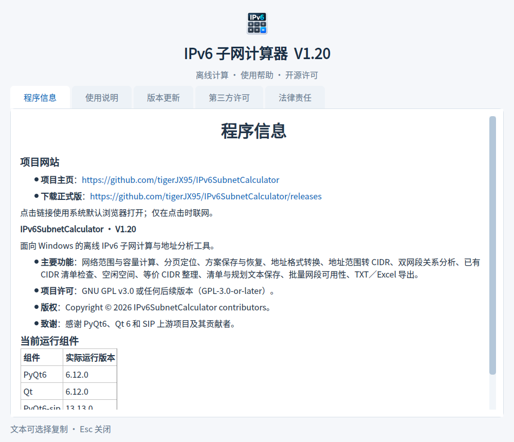
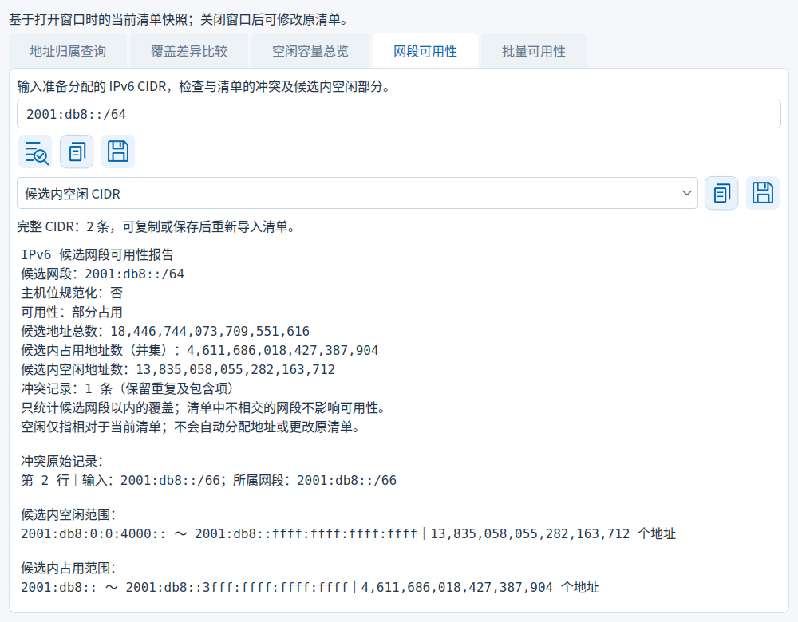

# 历史更新

[返回首页](../README.md)

仅收录当前版本之前的更新记录；当前版本见首页。

## V1.19 批量候选导入与运行组件更新

- 修订：修复 Windows 正常文件被误判为读取期间变化，恢复计算方案、规划项目和候选清单导入。

- 批量可用性新增 TXT／CIDR 和规划项目 JSON 导入；JSON 只取清单文本，保留注释、空行和重复候选。
- 替换已有候选前确认；取消、文件错误或对话框期间内容变化时保留原输入和结果，成功导入后再手动检查。
- 优化普通文件读取和变化提示；清单悬停内容按原文显示特殊字符。
- PyQt6 与 Qt 运行组件升级至 6.12.0，使用 Riverbank 官方预发布源；保持现有 PyQt 界面与单文件构建方式。
- 保留候选详情、内部 CIDR 输出、地址工具右键复制及关于页排版；同步中英文说明与对应语言截图。

## V1.18 批量候选详情与界面整理

- 批量可用性新增候选详情：按输入顺序选择序号，查看候选对应的基准冲突原始行、精确空闲／占用范围，复制或保存候选内部的空闲／占用 CIDR。
- 保留重复候选及原始行号，详情输入只读，按需检查单条候选；使用同一基准快照，不改变占用清单，也不为候选互相预留。
- 切换候选、修改批量输入或关闭查询窗口时清除旧详情，保存期间发生上述变化时拒绝旧输出。
- 合入展示修订：报告明确区分“输入／所属网段”；使用说明与版本日志分开，关于窗口仅展示当前 V1.18 日志；各正文大标题居中并与下方小标题留白。
- 保留按附件决定是否构建 EXE 的 Release 工作流，以及不抓取历史标签的 main 祖先校验；本版不修改历史标签或仓库设置。

操作和示例见[批量候选详情](BATCH_DETAILS.md)。

## ✨ V1.17 批量候选按状态输出

- 批量可用性新增“部分占用”“全部占用”“存在占用冲突”“全部候选”四种 CIDR 输出类别，保留原有全部空闲类别。
- 输出规范化后的完整候选网段，按首次输入顺序去重，保留包含项；不是候选内部的空闲或占用片段。上方完整报告始终保留全部记录，候选之间不会互相预留。
- 切换类别立即更新数量和按钮状态，保存期间切换类别会中止旧输出；空类别禁止输出空清单。
- Windows 构建只检出目标提交，发布时按需补齐 main 历史，不再抓取全部标签，避免历史标签大小写冲突；版本与 main 祖先校验继续保留，不删除或修改标签。

详见 [批量可用性说明](BATCH_AVAILABILITY.md) 与 [Release 构建说明](RELEASE_BUILD.md)。

### V1.16 Release 构建补充

发布 Release 时，已有完整 EXE 则跳过；没有 EXE 才自动构建、验证并上传 Windows x64 单文件 EXE。手动运行仅在 Actions 保留产物，不修改 Release。上传前再次检查附件，保留手动上传文件。见 [自动构建说明](RELEASE_BUILD.md)。

## ✨ V1.16 批量可用性与关于页面

- 新增“批量可用性”：每行一个候选 IPv6 CIDR，最多 5,000 条；对照当前占用清单逐条显示全部空闲、部分占用或全部占用，保留原始行号和重复候选。
- 报告显示各候选的精确占用／空闲地址数及与其他候选重叠的记录数；候选独立检查，不会互相预留，不代表可同时分配。
- 支持复制／保存完整报告及全部空闲候选 CIDR；纯 CIDR 去重但保留候选边界和包含项，空结果禁用输出。修改输入会清除旧结果，保存沿用冲突保护。
- 完善关于窗口：程序图标、实际版本、离线帮助、第三方许可和法律说明；项目主页及正式版下载地址以可点击超链接展示，仅点击时打开系统浏览器。保留右上角关闭和 Esc，去掉底部重复关闭按钮。

入口及示例见 [批量可用性说明](BATCH_AVAILABILITY.md)；关于页见 [关于与网站链接](ABOUT.md)。

## ✨ V1.15 候选网段可用性检查

- 在“子网清单”最上方第三个圆形靶心按钮打开的查询窗口中，新增“网段可用性”页签。输入准备分配的 IPv6 CIDR，判断相对于当前占用清单是否全部空闲、部分占用或全部占用。
- 报告列出所有冲突原始行号，保留重复和包含记录；占用容量按并集计数，只统计候选内覆盖，不相交记录不影响结果。主机位自动规范化。
- 可分别复制／保存候选内空闲与占用的最简 CIDR。结果为空或超过 5,000 条时禁止输出空清单或部分清单，完整范围报告仍可保存。此操作不自动追加或更改原清单。
- 修改候选立即清除旧结果；沿用覆盖确认和保存冲突保护。窗口使用打开时的清单快照，需更新基准时关闭重开；查询参数和结果不写入规划项目 JSON。
- 补全查询入口悬停说明。中文文档仅引用中文截图，英文文档仅引用英文截图；新增检查接入本地构建和 GitHub 质量检查。

## ✨ V1.14 空闲容量总览

- 在“子网清单”顶部查询窗口新增“空闲容量总览”页：输入父网段，一次统计父前缀至 /128 各级可分配的完整、对齐子网数量。
- 显示空闲地址数、占用并集容量、最大可用子网，以及各前缀下无法组成完整子网的零散地址数；同等大小的最大子网取地址最小者。
- 使用全部空闲范围计算，不受 5,000 条 CIDR 预览截断影响；容量使用精确整数，不枚举 IPv6 地址。每一行都是同一空闲空间的不同划分，不能跨行相加。
- 支持双语报告复制及 TXT 保存，沿用覆盖确认和文件冲突保护；修改父网段立即清除结果。基于打开窗口时的清单快照，不修改原项目，关闭后重开可使用最新清单。
- 占用清单必须全部有效且位于父网段内；空清单表示父网段全空闲。总览输入及结果不保存到规划项目 JSON，需要留存时保存报告。

入口：切换到 **子网清单**，点击最上方文件夹、保存按钮右侧的 **圆形靶心查询图标（第三个按钮）**，在弹窗中选择 **空闲容量总览**。此功能从 V1.14 开始提供。

## ✨ V1.13 查询与比较结果 CIDR 输出

- 地址归属查询支持复制及保存匹配网段 CIDR：规范化、去重，按最长前缀优先排列，保留包含项；原报告仍保留原始行号及重复记录。
- 覆盖比较可分别选择新增、移除、共同覆盖，生成精确覆盖结果的最简 CIDR 清单，支持复制及 TXT 保存后重新导入。
- 显示所选类别的 CIDR 条数。空结果不生成空清单；超过 5,000 条时禁用纯 CIDR 输出，完整地址范围报告仍可保存。
- 修改输入立即清除结果；保存期间切换类别或重新计算会中止旧结果保存。沿用现有覆盖确认及保存冲突保护。

### 🌐 翻译维护与异常显示

- 新增 TS/QM 一致性检查：核对翻译条目、上下文、完成状态、重复项及格式占位符；配套生成记录可发现翻译修改后漏编译或资源不匹配。
- 新增源码翻译遗漏扫描，检查 `text()` 及其导入别名、显式翻译调用和常用界面文本入口；检查接入构建前流程，回归测试及程序自检继续验证翻译资源。
- 新增翻译编译维护脚本，先在临时目录编译并检查，再更新 QM 及生成记录；编译或检查失败时保留原 QM。
- 翻译格式错误时回退原始消息，避免因占位符错误或译文行数变化引起显示异常；嵌套错误及后台清单错误保留翻译结构，文件路径及用户输入保留原文。
- 将范围分隔符正则移出翻译目录，输入语法不参与翻译。新增维护说明及针对资源损坏、漏翻译、异常显示的回归检查。

## ✨ V1.12 清单查询、覆盖比较与草稿保护

- 新增地址归属查询：输入 IPv6 地址，按最长前缀优先列出清单中所有匹配网段及原始行号，保留重复及包含项。
- 新增覆盖差异比较：当前清单作为基准，与粘贴或导入的 TXT／规划项目清单比较，精确统计新增、移除和共同覆盖的地址数与全部范围；等价 CIDR 拆分不产生虚假变化。
- 两项功能位于“子网清单”顶部查询图标，使用打开窗口时的清单快照；支持复制及 TXT 报告保存，沿用保存冲突保护。输入变化后清除旧结果。
- 单份清单继续限制为 5,000 条、1 MiB、20,000 行；空清单可用于比较全部新增或移除。错误行需修正后再查询或比较。

- 关闭程序或打开其他规划项目时，如有未保存内容，可选择保存、放弃或取消。
- 新草稿与已保存项目均显示未保存更改；只切换结果页签不触发提醒。
- 保存取消、冲突或失败时保留当前工作；提示期间内容变化会中止操作。

## ✨ V1.11 规划项目保存与恢复

- “子网清单”顶部新增打开／另存规划项目图标，分配建议页也可使用。
- 独立 JSON 保存清单原文（含注释和空行）、父网段、分配目标前缀、请求数量和结果页签；支持保存未完成的草稿。
- 恢复前验证文件并确认替换，恢复后清除派生结果，请重新检查或规划。此文件与原有“计算方案”格式分开；Ctrl+S／Ctrl+O 仍操作计算方案。
- 沿用保存冲突保护；对话框期间输入或任务变化时拒绝过期操作。已有项目修改后显示未保存状态。
- 规划项目需手动保存；退出或替换项目时提供未保存确认。

## V1.10 分配建议与保存保护

- 🐛 方案、TXT 保存与批量 TXT/XLSX 导出增加确认时文件快照及提交前冲突检测。原本不存在的目标采用原子无覆盖新建；同程序并发保存协调提交。
- 🐛 检出冲突时保留目标文件，并保留本次完整恢复输出，提示路径；取消仍清理未完成文件。拒绝覆盖目录、符号链接等非普通目标。
- 🐛 修复方案保存快照与“已保存”状态不一致；对话框期间状态变化时拒绝旧保存，后续修改保留未保存标记。
- 🌐 新增冲突、恢复路径及错误提示同步提供中英文。
- 📸 删除独立保存菜单截图及中英文 README 的相应引用，保留完整程序窗口截图。

保存保护的实际边界和恢复方法见 [保存冲突保护](SAVE_CONFLICTS.md)。

✨ 新增按目标前缀统计可分配子网数量；基于全部空闲区间计算，考虑 CIDR 对齐和碎片，不依赖被截断的空闲 CIDR 明细。
✨ 按数量生成最多 5,000 个候选网段，支持复制和 TXT 保存、完整容量报告；容量不足时不生成部分建议。
✨ 确认后将建议追加到原占用清单，保留已有内容及注释，自动重新计算剩余空闲空间。
🛡️ 追加前后检查状态快照，遵守清单原有的记录、字节与物理行限制；修改输入后清除旧建议。
🌐 新界面、提示、报告、帮助及截图同步提供简体中文和 English。保留 V1.9 双语修订。

## V1.9 清单输出与双语修订

### 🐛 双语一致性修订

- 修复简体中文模式下文件类型仍显示 File Folder，统一显示“文件夹”；文件类型、大小、日期和列名跟随应用语言。
- 第三方组件概览分别显示对应语言，许可原文保留。
- 修复动态标签、状态及提示中残留的中文标点。
- 补充主界面、菜单、弹窗、错误、进度、帮助、文件列表与双向切换回归。

### ✨ 清单与规划 TXT 保存

- 子网清单新增保存菜单：原始输入、有效去重 CIDR、检查报告。
- 空闲空间与 CIDR 整理支持保存完整 CIDR 清单或规划报告，报告使用保存时的界面语言。
- 原始输入保留编辑区注释、空行及原文；纯 CIDR TXT 可重新导入。
- 覆盖前确认，临时文件成功写入后才替换目标；失败保留原文件。

### ✨ 规划结果继续检查

- 完整空闲或整理结果可通过图标送回子网清单，自动执行校验与关系检查。
- 替换已有输入前确认，默认“否”；任务忙碌或确认期间来源变化时保留当前工作。
- 空闲明细截断时禁用完整 CIDR 保存与回流，报告仍保留全部空闲地址范围和精确统计。

### 🐛 状态与文档

- 保存对话框关闭后复核输入与结果，避免保存失效快照。
- 新操作适配中英文、浅深主题及最小窗口，并提供悬停提示。
- 更新双语 README、离线帮助与实际界面截图。
