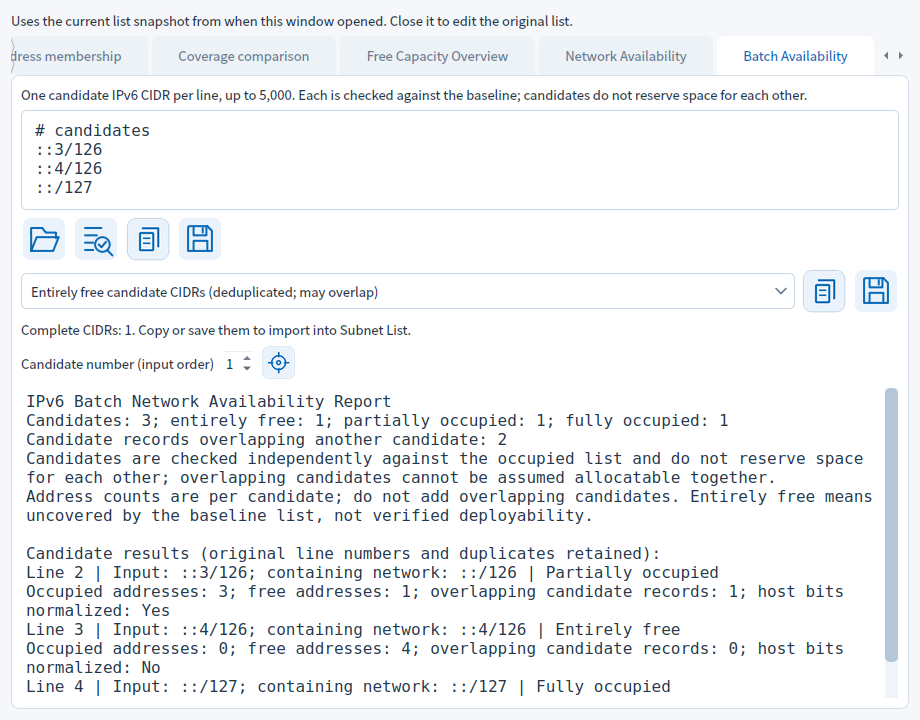
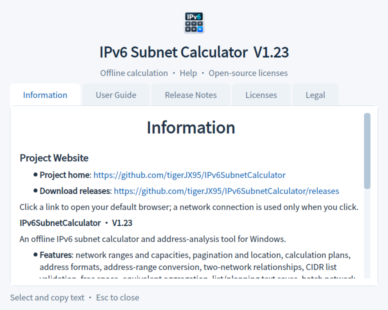

# Update History

[Back to home](../README_EN.md)

Changes preceding the current version; see the home page for the latest release.

## V1.22 Range Reports and Candidate Overlap Details

- Candidate details add a Report menu to copy or save a TXT report of every candidate matching the current browsing filter.
- Adds candidate overlap sources: other original candidate numbers and source lines, equality/containment relationships, intersection CIDRs and exact address counts.
- Overlap sources are computed on demand against all original candidates, including entries outside the browsing filter. Complete detail reports include them in copy/TXT output; free/occupied CIDRs still use the baseline list.
- Reports retain original candidate numbers, physical line numbers, duplicates, input and normalized networks, availability and exact address counts. Candidate overlap counts retain the statistics for all original candidates.
- Empty ranges disable report output. Filter changes, candidate edits or closing the window cancel pending old-report saves, including changing away and back to the same filter.
- Navigating within the same range keeps the complete range report valid. Reports use the interface language at actual save time, with overwrite confirmation and save conflict protection.
- Updates both languages, user instructions and actual interface screenshots. Home pages and About show only current notes; earlier releases use the Update History text link.

## V1.21 Browse Candidate Details by Status

- Candidate details add a Browse filter: all candidates, entirely free, partly occupied, fully occupied or any occupied overlap, with navigation between matching candidates.
- Retains original candidate numbers, physical source lines and duplicates. Bottom navigation and index jumps follow the filter; matched and total counts are shown.
- Empty filters clear old details and disable output. Changing the filter restores browsing and rejects pending saves of old details.
- The jump button adds a visible “Go” label; both languages, themes and the minimum window size are supported.
- Home pages and About show V1.21 only, with previous releases under the Update History text link; user instructions and actual interface screenshots are updated.

## V1.20 Continuous Candidate Details and Documentation Cleanup

- Batch candidate details use a fixed bottom navigation bar matching Subnet Results: first, previous, next, last, index jump and total count, synchronized with the batch-page candidate number.
- Retains duplicate candidates, physical line numbers, the baseline snapshot and the selected internal CIDR category; boundary buttons are disabled.
- Switching details clears old results and rejects pending saves of the previous candidate, without changing the baseline list or batch results.
- Home pages and About show only the current release. Earlier releases move to Update History, with offline history/return links in About.
- User instructions remain separate from release notes; both languages and matching actual interface screenshots are updated.

## V1.19 Batch Candidate Import and Runtime Update

- Revision: fixes unchanged Windows files being reported as modified during reading, restoring calculation-plan, planning-project and candidate imports.

- Batch Availability imports TXT/CIDR and planning-project JSON; JSON uses list text only, retaining comments, blank lines and duplicate candidates.
- Replacing candidates requires confirmation. Cancellation, file errors or dialog-time content changes preserve existing input/results; imported content is checked explicitly afterward.
- Improves ordinary-file reading and change messages; list tooltips display special characters literally.
- Updates PyQt6 and Qt runtime components to 6.12.0 from Riverbank's official pre-release index, retaining the existing PyQt interface and one-file build.
- Retains candidate details, internal CIDR output, address-tool context menus and About formatting; updates both languages and matching screenshots.

## V1.18 Batch Candidate Details and Interface Cleanup

- Batch Availability adds candidate details: select a number in input order to inspect baseline conflict source lines, exact free/occupied ranges, and copy or save CIDRs inside that candidate.
- Duplicate candidates and physical source line numbers are retained. Read-only details are computed on demand against the same baseline snapshot; they neither change the occupied list nor reserve space between candidates.
- Changing the selected candidate, editing batch input or closing inspection invalidates old details and rejects pending stale saves.
- Includes presentation revisions: explicit input/containing-network labels; separate user help and release notes, with only current V1.18 notes in About; centered main document titles with spacing before subheadings.
- Address-format and two-network results use context-menu copying instead of right-side copy icons, retaining continuous 128-bit binary and complete reports. Both languages, matching screenshots, i18n and security checks are updated.
- Retains attachment-aware EXE Release builds and main ancestry validation without fetching historical tags. This release does not change historical tags or repository settings.

See [Batch Candidate Details](BATCH_DETAILS_EN.md).

## ✨ V1.17 Candidate Output by Status

- Batch Availability adds partially occupied, fully occupied, conflicting and all-candidate CIDR categories alongside entirely free candidates.
- Output contains whole normalized candidate networks, deduplicated in first-input order with containment retained. These are not free/occupied fragments. The complete report retains every record; candidates reserve no space for each other.
- Switching categories updates counts and availability immediately. Switching during a save cancels stale output; empty categories cannot produce empty lists.
- Windows builds check out the target commit without fetching all tags. Release validation fetches main history on demand, avoiding historical case-variant tag conflicts while retaining version/ancestry checks and all existing tags.

See [Batch Availability](BATCH_AVAILABILITY_EN.md) and [Release builds](RELEASE_BUILD_EN.md).

### V1.16 Release build policy

Published Releases with an existing complete EXE skip compilation. Releases without one build, verify and attach the Windows x64 single-file EXE. Manual runs retain output in Actions only. Attachments are checked again before upload to preserve manual files. See [Release build guide](RELEASE_BUILD_EN.md).

## ✨ V1.16 Batch Availability and About

- Added Batch Availability: one candidate IPv6 CIDR per line, up to 5,000. Check each against the occupied list as entirely free, partially occupied or fully occupied, retaining original line numbers and duplicate candidates.
- Reports show exact occupied/free address counts and the number of other overlapping candidate records. Checks are independent and reserve no space; candidates are not necessarily allocatable together.
- Copy or save complete reports and entirely free candidate CIDRs. CIDR output removes duplicates while preserving candidate boundaries and containment; empty output is disabled. Edits clear stale results and saves retain conflict protection.
- Updated About with the application icon, actual version, offline help, component licenses and legal information. Project home and release downloads are clickable links that open the default browser only on click. Use the title-bar close button or Esc; the duplicate footer close button was removed.
- Updated both languages, documentation and matching-language screenshots; retained V1.15 i18n and security checks.

See [Batch Availability](BATCH_AVAILABILITY_EN.md) and [About and Website Links](ABOUT_EN.md).

## ✨ V1.15 Candidate Network Availability

- Added Network Availability in the list tools window opened from the third, target-shaped icon at the top of Subnet List. Enter a candidate IPv6 CIDR to determine whether it is entirely free, partially occupied or fully occupied relative to the occupied list.
- Reports preserve all original conflicting line numbers, including duplicates and containing entries. Occupancy counts the union within the candidate only; disjoint entries do not affect the result. Host bits are normalized.
- Copy or save minimal CIDRs for free or occupied coverage within the candidate. Empty results and outputs exceeding 5,000 CIDRs cannot produce empty or partial lists; complete range reports remain available. Nothing is appended or allocated automatically.
- Editing the candidate clears stale results. Saves retain overwrite confirmation and conflict protection. The window uses the list snapshot taken when opened; reopen to refresh it. Query parameters and results are not stored in planning project JSON.
- Expanded the list tools tooltip. Chinese documents reference Chinese screenshots only, and English documents reference English screenshots only. Checks run before local builds and in GitHub quality checks.

## ✨ V1.14 Free Capacity Overview

- Added a Free Capacity Overview tab in the Subnet List lookup window. Enter a parent network to count complete, aligned available subnets at every prefix from the parent prefix through /128.
- Shows free addresses, occupied union size, the largest available subnet and fragmented addresses that cannot form a complete subnet at each prefix. Equal-sized largest subnets use the lowest address.
- Uses complete free ranges even when the 5,000-CIDR preview is truncated. Counts are exact integers without enumerating IPv6 addresses. Rows partition the same free space differently and must not be added together.
- Copy bilingual reports or save TXT with overwrite confirmation and conflict protection. Editing the parent clears results. The list snapshot is taken when the window opens; original projects are unchanged. Reopen to use an updated list.
- All occupied records must be valid and contained within the parent; an empty list leaves the entire parent free. Overview inputs and results are not stored in planning project JSON; save the report to retain them.

## ✨ V1.13 CIDR Output for Lookup and Coverage Results

- Copy or save matching CIDRs from address lookup: normalized, deduplicated and ordered by longest prefix, retaining containing networks. Reports still preserve original line numbers and duplicate records.
- Select added, removed or common coverage and produce its exact minimal CIDR list. Copy or save TXT for reimport into Subnet List.
- Show the selected CIDR count. Empty categories cannot produce empty files; results exceeding 5,000 CIDRs disable list output while complete range reports remain available.
- Editing inputs invalidates output. Changing category or recalculating during a save dialog aborts stale output; overwrite confirmation and save conflict protection still apply.

### 🌐 Translation Maintenance and Error Display

- Added TS/QM consistency checks for messages, contexts, completion state, duplicates and format fields. Generation records detect missing recompilation and mismatched resources.
- Added source coverage checks for `text()` aliases, explicit translation calls and common UI text setters. Checks run before building; regression tests and application self-checks also validate catalog resources.
- Added a translation maintenance script that compiles and validates in a temporary directory before updating QM and its generation record. Failed compilation or validation preserves the existing QM.
- Malformed translation formats and missing translated lines fall back to the original message. Nested exceptions and background list errors retain localized structure; filenames and user content remain unchanged.
- Removed the range-separator regular expression from the catalog so parsing syntax is not translated. Added maintenance documentation and regression checks for damaged resources, missing translations and error display.

## ✨ V1.12 List Lookup, Coverage Comparison and Draft Protection

- Added address membership lookup: list all containing networks and original line numbers, longest prefix first, including duplicates and containing entries.
- Added coverage comparison: compare the current list with pasted or imported TXT / planning project lists, with exact added, removed and common address counts and complete ranges. Equivalent CIDR splits do not create false changes.
- Open both tools from the lookup icon at the top of Subnet List. They use a snapshot from when the window opened and support copying and conflict-safe TXT report saving. Editing inputs clears old results.
- Each list retains the 5,000-record, 1 MiB and 20,000-line limits. Empty lists support all-added or all-removed comparisons. Correct invalid records before querying or comparing.

- Save, discard or cancel unsaved planning changes before closing or opening another project.
- New drafts and saved projects display their modified state. Switching result tabs alone does not trigger a reminder.
- Cancelled, conflicting or failed saves preserve current work. Changes during confirmation abort the action.

## ✨ V1.11 Planning Project Save and Restore

- New open/save-as icons at the top of Subnet List remain accessible on the Allocation Suggestions tab.
- Separate JSON preserves the original list (comments and blank lines included), parent network, allocation prefix, requested count and result tab. Unfinished drafts are supported.
- Files are validated before replacement confirmation. Restoring clears derived results; run checks or planning again. This format is separate from calculation plans; Ctrl+S/Ctrl+O still operate calculation plans.
- Reuses save conflict protection and rejects stale actions when inputs or tasks change during dialogs. Changes to saved projects are marked as unsaved.
- Projects require manual saving; closing or replacing a project prompts for unsaved work.
- Qt pins retain the verified baseline. The pending security upgrade is not resolved by this feature release.

## V1.10 Allocation Suggestions and Save Protection

- 🐛 plans, TXT saves and bulk TXT/XLSX exports retain the approval-time destination revision and check for conflicts at commit. Initially absent targets use atomic no-overwrite publication; cooperating application processes coordinate existing-file commits.
- 🐛 Conflicts preserve the destination and complete recovery output, with a reported recovery path. Cancellation still removes incomplete files. Directories, symbolic links and other nonregular targets cannot be overwritten.
- 🐛 fixed saved-plan snapshot tracking. Changes during dialogs invalidate the save; later changes remain dirty.
- 🌐 Conflict and recovery messages support both interface languages.
- 📸 Removed standalone save-menu screenshots and their Chinese/English README references, retaining full application-window screenshots.

See [save conflict protection](SAVE_CONFLICTS.md) for recovery steps and concurrency limits.

✨ Count available subnets for a target prefix using all free intervals, including alignment and fragmentation, independently of truncated free CIDR details.
✨ Generate up to 5,000 candidates on request. Copy or save CIDRs and capacity reports as TXT. Insufficient capacity produces no partial suggestions.
✨ Confirm to append candidates to the occupied list, retain existing content and comments, and recalculate remaining free space.
🛡️ Recheck snapshots around confirmation and enforce existing record, byte and physical-line limits. Input changes invalidate old suggestions.
🌐 New controls, tooltips, reports, help and screenshots support Simplified Chinese and English. V1.9 bilingual fixes are retained.

## V1.9 List Output and Bilingual Revision

### 🐛 Bilingual Consistency Revision

- Fixed File Folder appearing in Chinese file dialogs. Folder/type labels, sizes, dates and headers now follow the application language.
- Localized the component overview while preserving original license texts.
- Fixed Chinese punctuation remaining in assembled labels and messages.
- Added coverage for pages, menus, dialogs, errors, progress, help, file lists and live language switching.

### ✨ Save List and Planning Text

- Subnet List adds a save menu for original input, valid deduplicated CIDRs and check reports.
- Free Space and Aggregation save complete CIDR lists or planning reports. Reports use the interface language at save time.
- Original input retains editor comments, blank lines and user text; CIDR TXT can be reimported.
- Overwriting requires confirmation. Temporary-file writes replace the destination only on success, preserving existing files after failure.

### ✨ Continue Checking Planning Results

- Send complete free/aggregated CIDRs back to Subnet List for automatic validation and relationship checks.
- Replacing existing input defaults to No. Busy tasks and changed source results preserve current work.
- Truncated free-space details disable complete CIDR saving and transfer; reports retain all free address intervals and exact counts.

### 🐛 State and Documentation

- Revalidates input and result snapshots after save dialogs to reject stale output.
- New actions support both languages, themes and minimum window size with tooltips.
- Updated bilingual READMEs, offline help and actual application screenshots.
