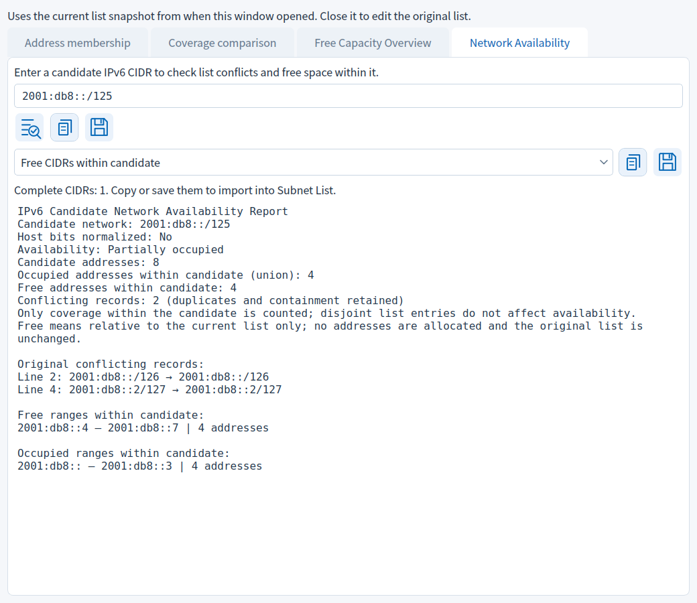

[简体中文](NETWORK_AVAILABILITY.md) | [Home](../README_EN.md)

# Candidate Network Availability

Open Subnet List → the third, target-shaped icon in the top row → Network Availability. The icon is to the right of the planning project open/save icons, not the list check button below the editor. At small window sizes, scroll the tab bar to reach later tabs.

The current list represents occupied networks. Enter a complete IPv6 CIDR and click Check or press Enter. Host bits are normalized. Every list entry must be valid; empty lists are supported. Disjoint entries do not affect the result and do not need to fall within the candidate.

## Example

Occupied list:

```text
# Occupied networks
2001:db8::/126
2001:db8::10/124
2001:db8::2/127
```

Enter candidate `2001:db8::/125`. It contains 8 addresses. Conflicting original lines are 2 and 4, the occupied union contains 4 addresses, and 4 remain free. Status is Partially occupied. Free CIDRs: `2001:db8::4/126`; occupied CIDRs: `2001:db8::/126`. Line 3 is disjoint and does not conflict.



## Output and persistence

The upper copy/save buttons output the full report, including original conflicting records and all free/occupied ranges within the candidate. Choose Free CIDRs within candidate or Occupied CIDRs within candidate below, then copy/save a pure CIDR list for reimport. Nothing is appended or allocated automatically. Empty results and results exceeding 5,000 CIDRs cannot produce empty or partial lists; full reports remain available.

Editing the candidate clears stale results. Changes to input, result or category during saving abort stale output. Reports follow the UI language. Overwrite confirmation and destination conflict protection remain active.

The window uses the list snapshot from when it opened. Close, edit the original list and reopen to refresh the baseline. Query inputs, output category and reports are not stored in planning project JSON. Save reports or CIDR TXT separately. Free means relative to the supplied list only and does not establish actual deployment availability.
